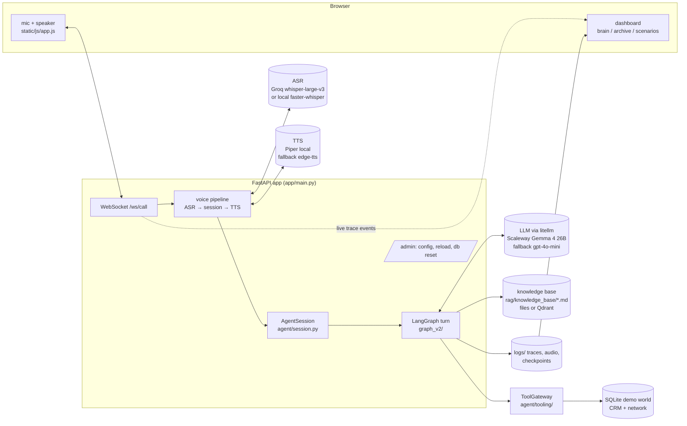
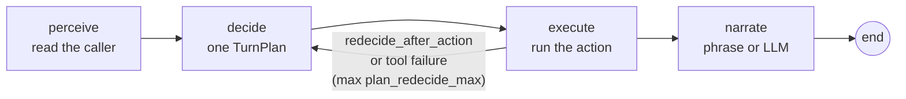

# Architecture — how the agent works

> State of `develop` @ `6623c53` (2026-10-15). Every statement here was checked against the code,
> not against older documents. Paths are relative to `chatbot_core/src/` unless they start with
> another top-level folder. The *why* behind most choices is in [DECISIONS.md](DECISIONS.md)
> (D-01…D-22) and the live review [review/PERZIURA.md](review/PERZIURA.md) (principles P-1…P-9).

---

## 0. In one paragraph

The agent is a **deterministic engine with a model that listens and speaks** — not a model with
instructions. Code decides what to ask, what to check, what to tell and when to register a
technician, and it decides from **facts**. Facts come from telemetry, the CRM and the caller's
answers. The LLM does two jobs: it **reads** what the caller said (as a fact plus the caller's own
quote, which code verifies), and it **words** what the engine decided. Fault logic lives in **data**
— cards, modules, an equipment catalogue, phrases — so a new fault is usually new YAML, not new code.

---

## 1. Principles the code enforces

| # | Principle | Where it is enforced |
|---|---|---|
| 1 | **The engine decides, the model speaks.** The speaker has no tools; one plan per turn. | `decide/` builds a `TurnPlan`; `speak/` only words it |
| 2 | **No fact without a quote.** A fact the model reports must carry the caller's words, and code checks those words are in the utterance. | `perceive/perception.py` (`ground`) |
| 3 | **Telemetry is the arbiter.** A caller's claim never overwrites a fact telemetry owns. | `ledger.py` (`record_client`) |
| 4 | **Identity first.** Account, billing and telemetry tools run only for a committed customer; a phone-number match is only a candidate. | `tooling/gateway.py` (`requires: identified`), `execute/identification.py` |
| 5 | **Knowledge is data.** Cards, modules, equipment, phrases, limits, policies are YAML validated at startup. | `agent/knowledge/`, `agent/contract/` |
| 6 | **No improvisation on unknown faults.** No card fits → an “unclear fault” ticket, not a guess. | `case.py` fallback `unclear_fault` |
| 7 | **Every call leaves a record**, identified or not. | `call_record/finalizer.py` |
| 8 | **A human is reached only through a ticket.** | `execute/ticket.py`, `knowledge/registracija.yaml` |

---

## 2. System map



Folders:

| Folder | What |
|---|---|
| `chatbot_core/src/agent/` | the agent: graph, engine, knowledge, prompts, locale |
| `chatbot_core/src/app/` | FastAPI service, Pipecat voice (WebRTC), dashboard, archive, admin |
| `chatbot_core/src/adapters/` | ASR, TTS, retrieval (Qdrant, embeddings), tracing |
| `chatbot_core/src/services/llm/` | the one LLM client (litellm), providers, fallback, rate limit, stats |
| `chatbot_core/src/rag/knowledge_base/` | Markdown documents the agent can read to the caller |
| `crm_service/`, `network_diagnostic_service/` | demo CRM and network systems (MCP servers + repositories) |
| `database/` | SQLite schema and seeds for the demo world (Šiauliai) |
| `shared/` | shared helpers for the two services |
| `scripts/` | DB setup, Piper voices, log pruning, trace analysis |

---

## 3. One call

```
 browser connects ─► AgentSession created (new_call: empty GraphState + AgentRuntime)
        │
        ▼
 greeting()  ── rule dialog.greeting → fixed phrase + preflight_phone (caller-ID lookup = candidate only)
        │
        ▼
 ┌─► handle_turn(text) ── one LangGraph run (§4) ── reply streamed sentence by sentence to TTS
 │      │
 │      ▼   between turns (voice): analyst reads in background · telemetry re-check · delivery report
 └──────┘
        │  caller hangs up / agent closes / socket lost (30 s grace)
        ▼
 end_session() ─► finalizer: hang-up nets → outcome → contact record row → session_end
```

- **`agent/session.py`** — owns one call. Builds the graph with a checkpointer
  (`graph_v2/checkpoint.py`: one SqliteSaver per process at `logs/graph_checkpoints.sqlite`;
  in-memory for tests and eval), `thread_id` = session id. Between turns it writes through
  `graph.update_state` (delivered sentences, background inbox).
- **`agent/runtime.py`** — `AgentRuntime`, the per-call context passed to every node: config,
  tracer, tool gateway, cancel event (barge-in), ended event, LLM stats, clock.
- **`call_record/finalizer.py`** — runs exactly once however the call ends. It registers a promised
  but missing ticket, closes a hang-up on a homework step as a callback, derives the outcome
  deterministically (`call_record/outcome.py`), writes one row to `conversations`, and for an
  unidentified call stores the reason (`stuck`, `not_a_customer`, `caller_refused`,
  `address_not_found`, `hung_up`), `needs_review` and an audio retention date.

---

## 4. One turn — the graph

There is exactly one graph: `graph_v2/graph.py`.



| Node | File | Does | LLM |
|---|---|---|---|
| **perceive** | `perceive/node.py` | applies analyst signals from the inbox; turns the utterance into facts, a step answer, a problem label, a side topic; mirrors facts into the Case | **sometimes** (§6) |
| **decide** | `decide/node.py` | runs the rule chain, returns one `TurnPlan`, passes it through the gate | no |
| **execute** | `execute/node.py` → `execute/actions.py` | runs the plan's action: tool, register/append ticket, close | no |
| **narrate** | `execute/node.py` → `execute/say.py` | speaks: a fixed phrase, pre-written text, or an LLM-worded directive | only for a directive |

Every node is wrapped in `timed()` (`graph_v2/runtime.py`), which traces its duration. The engine
part (decide + execute) takes ~2–10 ms; the time is in the LLM, ASR and TTS (§12).

### 4.1 State

`graph_v2/state.py` — one Pydantic `GraphState`, the only truth between nodes (D-01). Groups:

| Group | Holds |
|---|---|
| `messages` | the conversation |
| `identity` | caller, CRM match, `customer_id` (committed only by `set_customer`), address slots |
| `intake` | problem type, secondary problems, heard utterances |
| `diagnosis` | evidence ledger v1, verdicts, the open contradiction |
| `case` | **the live diagnosis**: facts, active fault, solution step, asks, summary |
| `ticket` | contact dialogue (phone, hours) and the ticket context |
| `dialog` | active question, repeat guard, phase (shadow), turn count |
| `closing` | closing flags (written only by `closing.py`) |
| `voice` | analyst tone signals, background mode, what was said and what is still owed |
| `tools` | per-call tool counters |
| `resolution` | mostly legacy counters (see §13) |
| `turn` | scratch for this turn only: plan, perception, tool failure |

### 4.2 Phases

`phase.py` defines six phases — **greeting → intake → identify → investigate ⟲ → ticket →
closing** — and an allowed-transition table (design: [review/STRUKTURA_V3.md](review/STRUKTURA_V3.md)).
Today the phase is **derived** from state after each turn (`phase_of`) and traced; an unexpected
transition is flagged. Rules still own the real transitions. The phase is already *read* for three
things: skipping the LLM reader in identify/closing, choosing the speak prompt block, and the
hang-up note.

---

## 5. Decide — one plan per turn

### 5.1 The TurnPlan (`decide/plan.py`)

```
TurnPlan
 ├─ owner      intake | identification | inform | side_topic | diagnosis | procedure | ticket | closing
 ├─ rule       which rule fired, e.g. case.ask, ticket.capture_phone
 ├─ action     tool | register_ticket | append_ticket | close | none   (+ name, args)
 ├─ say        phrase (locale key or engine text) | directive (English goal for the speaker) | none
 ├─ awaiting   the fact / step / question we now wait for
 └─ redecide_after_action   look, then decide again in the same turn
```

The plan is shown live in the dashboard's “brain” panel and traced as `turn_plan`.

### 5.2 The rule chain (`decide/policy.py`)

First non-empty plan wins:

```
1 dialog.greeting
2 closing                    farewell, “anything else?”, close
3 tools.unavailable          a failed tool's manifest fallback (ask / ticket / end / skip)
4 ticket                     the contact dialogue (phone, hours, consent)
5 head guards                end/reopen confirm, farewell mid-process, name confirm,
                             caller intro, unidentified address, address correction
6 stage.plan                 not identified → identification reply
                             else: ensure_diagnosed (telemetry) → side topic →
                                   inform news → case_rule.plan → free reply
                             then the scripted reply layer (rules/reply.py)
```

Rule files: `decide/rules/*.py`. `case_rule.py` is where the diagnosis runs (§5.4).

### 5.3 Gate, question, contradiction

- **Gate** (`decide/gate.py`) drops an action that is forbidden by `policies.yaml`, is not a tool in
  `knowledge/tools/*.yaml`, or closes with an unknown reason. The words stay; the rule id gets
  `.gated`.
- **One open question per call** (`decide/question.py`), owned by safety > ident > ticket > walker;
  re-asks are counted.
- **Contradiction** (`decide/hypothesis.py`): when the caller or telemetry contradicts an earlier
  fact, the engine opens one doubt and asks once, quoting the caller — “you said X, now Y — which
  is it?” — before changing anything.

### 5.4 The Case — how a fault is diagnosed (`case.py`, `decide/rules/case_rule.py`)

The Case is a **pure function of facts over cards**.

```
              facts (telemetry · CRM · caller · modules)
                               │
                               ▼
     judge every card:  matched │ possible (a fact unknown) │ ruled_out
                               │
             ┌─────────────────┼──────────────────────────────┐
             ▼                 ▼                              ▼
   a matched NEWS card   exactly one matched,          several possible
   (outage, debt, …)     none possible                 → learn the fact that
   → INFORM              → SOLVE: first solution        splits most candidates
                           branch whose `when` holds     (cheapest source first:
                                                          probe → module → ask)
             nothing open / nothing left to learn → ESCALATE (unclear_fault ticket)
```

- An **unknown fact never counts as false**.
- **Facts are learned cheapest first**: a telemetry probe (`knowledge/signals.yaml`), a module that
  produces it, or a question from the card's `needs`.
- **Solving** runs one module step per turn (`modules.py`). Each step can be skipped when already
  achieved (`done_when`), not applicable (`skip_when`) or gated (`run_when`); `verify` steps re-read
  telemetry and must agree with the caller's own answer.
- **Re-check every turn**: a new fact that rules out the active card drops it.
- **Failure**: `on_fail` once, then the fault is marked spent and the Case reopens — another card
  may still fit.
- **Patience**: a fact asked twice without an answer is assumed (`needs.assume`), explained
  (`critical`) or marked unavailable. Stall and repeat limits are in `knowledge/limits.yaml`.
- **Escalation**: `escalate.only_after` forces phone work first (e.g. reboot before a technician);
  the conclusion is spoken on its own turn, then `execute/ticket.request_ticket(reason)` with a
  reason from the closed list in `knowledge/registracija.yaml`.

---

## 6. Perceive — reading the caller

Reading is a ladder: **cheap and certain first, the model only when needed** (stage 6b cut LLM
reads by 65 %).

```
utterance
   │
   ├─ 1. engine readers (perceive/perception.py  fast_read / _engine_read)   no LLM
   │      ≤ 6 words, no confusion: phone & hours in the ticket dialogue, problem keywords,
   │      identification answers, thanks/goodbye, backchannels (“mhm”), a module step's own
   │      closed answer set (detectors + vocabulary.yaml)
   │
   ├─ 2. one merged LLM read (perceive/understand.py)                          LLM, JSON
   │      facts {key: value, quote}, type (answer/question/deviation/confusion/contradiction),
   │      step answer, knowledge document pick, ticket answer, problem label
   │      → values checked against the allowed sets; facts without a verified quote dropped
   │
   └─ 3. ingest (perceive/evidence.py → ledger.py → case.facts)
```

**Analyst** (`analyst/`) reads the whole conversation and returns typed **signals** —
contradiction, already answered, secondary problem, deviation, mood. It never writes facts, never
changes the hypothesis, never talks to the caller; it can only raise a doubt that decide then
handles. It runs only when due (stuck, repeat, ticket/debt turns, or every 3rd turn). `ANALYST_MODE`:
`sync` (after the reply), `async` (voice: in the background between turns, applied next turn), `off`.

---

## 7. Speak — wording the decision

`narrate` speaks in one of three ways:

| `say.kind` | What the caller hears | LLM |
|---|---|---|
| `phrase` | a fixed sentence from `locales/lt/phrases.yaml` (or engine-built text) | no |
| `written` / `committed` | text already prepared by the engine | no |
| `directive` | the engine's English goal, worded by the model in Lithuanian | yes, streamed |

The speak prompt (`speak/node.py`) is assembled as:

```
system   = speak/system.md (+ partials/identity.md, language instruction & fixes)
         + phase block      prompts/phases/{identify | investigate | ticket}.md
         + skill            prompts/skills/<skill>.md   ← chosen by speak/skill.py
           (few-shot examples expanded from locales/lt/examples/*.md)
           — kept byte-identical between turns so the provider's prompt cache stays warm
summary  = fixed-format summary when history overflows (no LLM)
history  = last 10 messages
card     = context card (speak/context_card.py): facts, step, goal, open question, KB passage
```

**Skills** (by situation): `ask_fact`, `ask_identity`, `instruct_step`, `explain_finding`,
`inform_news`, `answer_side`, `reexplain_confused`, `sum_up`, `ticket_offscript`, `goodbye`.

**Output guard** (`speak/guard.py`, `speak/postprocess.py`): releases whole sentences only, stops
after the first question or ~200 characters, **drops a promise nothing backs** (“I'll register…”
with no ticket decided), fixes Lithuanian words from `locales/lt/kalba.yaml`, trims to 280
characters. Barge-in cancels the stream between tokens.

---

## 8. Every LLM call

All go through `services/llm/client.py` (litellm), tagged by role.

| Role | Where | Prompt | When it runs | Model |
|---|---|---|---|---|
| `perception` | `perceive/understand.py` | `prompts/sensors/perception*.md`, `knowledge_route.md`, `ticket_reader_*.md`, `problem_in_perception.md` | turns the engine readers could not read | `PERCEPTION_MODEL` → `LLM_MODEL`, t=0, ≤200 tok |
| `ticket_reader` | `perceive/understand.py` | `sensors/ticket_reader*.md` | only if the merged read gave no ticket answer | same |
| `problem_classifier` | `perceive/nlu.py` → `classifier.py` | `sensors/classifier.md` + `problem_classifier.md` | problem still unknown and keywords failed | same, ≥0.8 commit, ≥0.5 confirm |
| `analyst` | `analyst/node.py` | `sensors/analyst.md` | when due (§6) | same, t=0.2, ≤700 tok |
| `speak` | `speak/node.py` | §7 | `say.kind = directive` | `LLM_MODEL`, t=0.2, ≤150 tok, streamed |

**Providers** (`services/llm/endpoints.py`, chosen by the model-id prefix): `scaleway/…` (EU API),
`local/…` (Ollama or any OpenAI-compatible server), plain ids (OpenAI), `groq/…`, `gemini…`.
Current `.env`: `LLM_MODEL=scaleway/gemma-4-26b-a4b-it`, `LLM_FALLBACK_MODEL=gpt-4o-mini`.

**Fallback**: with a fallback configured the primary gets one try with an 8 s timeout; twice-invalid
JSON also switches; when streaming, only before the first token. **Rate limit**: 30 calls/min per
process, 100 per conversation (`services/llm/rate_limiter.py`).

Other models:

| What | Default | Alternative | Files |
|---|---|---|---|
| ASR | Groq `whisper-large-v3` (cloud) | local faster-whisper `small` (CPU) | `adapters/asr/`, `lt_text.py` normalises numbers |
| TTS | **Piper local**, voices Reginutė / Ingutė | edge-tts (Leonas), gTTS | `adapters/tts/`, voices in `models/tts/piper/` |
| Embeddings | `multilingual-e5-small` (384-d, 150 ms timeout) | — | `adapters/retrieval/embed.py` |
| Search | lexical over Markdown files | Qdrant hybrid (`KB_BACKEND=qdrant`) | `knowledge_base.py`, `adapters/retrieval/qdrant_store.py` |

---

## 9. Knowledge — what an instructor edits

All under `agent/knowledge/` and `agent/locales/lt/`, validated at startup by
`contract/loader.startup()` — a broken file stops the app with a list of errors.
`POST /admin/knowledge/reload` re-validates and reloads without a restart.

```
knowledge/
├─ v2/cards/        16 diagnoses + fallback          WHEN this is the fault, WHAT we still need, HOW to fix
├─ v2/modules/      17 reusable steps                 ask · instruct · action · verify · escalate
├─ v2/equipment/    router → tplink, tv_box, computer, phone    the words for “press the power button”
├─ signals.yaml     telemetry signal → fact           what a probe can tell us
├─ intents.yaml     why people call                   solve / register / answer / chat / not ours
├─ services.yaml    internet, tv, phone + dependencies (IPTV and VoIP depend on internet)
├─ ticket_types.yaml  8 types → department, priority
├─ registracija.yaml  closed list of reasons a ticket may be registered
├─ inform.yaml      how to tell news (outage, debt)
├─ faq.yaml         side questions and their answers
├─ identification.yaml  identification knobs
├─ limits.yaml      every number (patience, lengths, timeouts), each with an env override
├─ policies.yaml    forbidden actions / topics
├─ tools/*.yaml     14 tool manifests: adapter, guards, timeout, fallback, returns
├─ detectors.yaml   meanings for code detectors
└─ verdicts.yaml    legacy verdict flags
locales/lt/
├─ phrases.yaml     every fixed sentence
├─ vocabulary.yaml  keywords for every engine reader
├─ kalba.yaml       word corrections after the LLM
└─ examples/*.md    few-shot examples for prompts
rag/knowledge_base/ Markdown docs (troubleshooting, equipment, procedures, FAQ) with tags
```

**Cards today** — all internet (`symptom: internet_down`):

| Fault cards | News cards (inform, no fix) | Engine-named |
|---|---|---|
| `router_hung`, `crc_errors`, `dhcp_silent`, `foreign_mac`, `healthy_to_router`, `link_down_local`, `no_mac_observed` | `active_outage`, `billing_suspended`, `node_fault_unregistered`, `switch_unreachable`, `no_port_data` | `service_not_subscribed`, `open_ticket_exists`, `no_open_ticket`, fallback `unclear_fault` |

How to add a new fault, step by step, belongs to the instructor guide (planned; the current
[instructor/FAULT_PACKS.md](instructor/FAULT_PACKS.md) still describes the old v1 format — see
[STATUS.md](STATUS.md)).

---

## 10. Tools and the outside world

```
plan.action = tool ──► ToolGateway (tooling/gateway.py)
                         1 gate: manifest exists · identified if required · max_per_call · cooldown · hours
                         2 adapter call with timeout (retry only read-only capabilities)
                         3 observation → state (execute/observe.py)
                         4 check declared `returns`
                         5 failure → fallback from the manifest (ask / ticket / end / skip) + ops alert
```

- **Adapters** (`tooling/adapters.py`): `demo_db` (all 14 manifests today), `rag_local`, `fake`
  (tests). The schema already accepts `mcp:<server>` and `http:<service>`, but **no such adapter is
  implemented** — this is the integration seam.
- **Demo world**: `agent/tools.py` calls the CRM and network services' Python functions in-process
  (`crm_service/src`, `network_diagnostic_service/src`) over `database/isp_database.db`. Both
  services are also real MCP servers, but the agent does not speak MCP to them yet.
- **Physical actions in demo**: the caller's reboot/cable/bridge are simulated (`SIMULATE_REBOOT`,
  `SIMULATE_BRIDGE`, dashboard buttons, `scripts/sim_plug_cable.py`).
- **Tickets**: 7 that create a ticket (`fault_technician`, `equipment_replacement`,
  `fault_unclear`, `billing_request`, `disconnection_request`, `service_transfer`,
  `customer_wish`) + `repeat_contact` (a note on an open ticket).

---

## 11. Voice

```
browser mic ──WebRTC (POST /sessions/{id}/webrtc)──► Pipecat pipeline (app/pipecat_call.py)
   Silero VAD → Smart Turn v3 (end of turn) → ASR (Groq Whisper)
                                   ▼
                     EngineProcessor ──► AgentSession.handle_turn_stream
                                   │ sentences as they stream
                                   ▼
                     TTS per phrase (Piper in worker processes; scripted lines from the PCM cache)
                                   │
browser speaker ◄──────────────────┘   barge-in: finish the phrase, then decide (agent/barge_in.py)
```

The WebSocket `/ws/call/{id}` carries only the dashboard's events and typed (text) turns.
Files: `app/pipecat_call.py` (the call: transport, turn taking, check-in, closing silence,
hang-up, recording), `app/voice.py` (builds ASR/TTS, prewarm), `agent/voice_pipeline.py`
(the spoken form of a reply), `agent/delivery.py` (what the caller actually heard; required
information said again once). **There is no telephony yet** — the browser is the phone.
The old own-WebSocket voice path was deleted (A5, 2026-10-20).

---

## 12. Latency

Measured on live calls (2026-10-05, 3 calls / 59 turns, median), before Piper and stage 6b:

| Layer | Now | Target |
|---|---|---|
| ASR (final) | ~550 ms | 100–200 ms (streaming ASR) |
| LLM read (perception) | ~1 550 ms → now skipped on most short turns (6b) | 150–300 ms |
| Engine (decide + execute) | ~2 ms | — |
| LLM speak, first token | ~1 150 ms | 150–300 ms |
| TTS first audio | ~270 ms (Piper) | 80–150 ms |
| **First audio to caller** | **~3.0 s** (p90 4.5 s) | **≤ 1.5 s** demo, < 1 s product |

Two serial LLM calls are the cost. Levers: fewer reads (done in part), written phrases instead of
directives, a local GPU model, streaming ASR.

---

## 13. Observability and quality

- **Traces**: JSONL per call in `logs/sessions/` (~47 event types: `graph_node`, `turn_plan`,
  `tool_call`, `verdict`, `llm_input`, `skill`, `reply_guard`, `barge_in`, `voice_latency`, …), PII
  redacted (`adapters/tracing/jsonl_tracer.py`). Streamed live to the dashboard and replayed in the
  archive.
- **Versions on every call** (`agent/versions.py`): `session_start` carries the git commit
  (`+changes` when edited), hashes of the knowledge, locale, prompts and documents, and the
  models — so a call after a change can be compared with one before it.
- **What the LLM saw**: `DEBUG_LLM=full` (the development default; config page) writes every
  call's messages and answer into its `llm` event and the speaker's context card and messages
  into `llm_input`; `card` keeps the card only, `off` numbers only (production).
- **Dashboard** (`app/static/`): Testing, Scenarios (19 demo calls, `app/scenarios.yaml`) and
  Archive. Live (Testing) shows the **flow** (`flow.js`): phases, one line of what is known, and
  every turn as short steps tagged by the engine part doing them (klientas → supranta →
  sprendžia → įrankis → žinios → sako); a step opens in place. After the call the Archive
  analyses it: transcript and audio, the same flow, and a detail panel — a step in full (for an
  LLM step: goal → input → output; for a tool: arguments → result; for the plan: the rule chain
  from the `policy` event) or a turn's whole breakdown (`why.js`: heard, read, decided, tools,
  knowledge, prompt, said, latency strip, state change).
- **Monitoring** (`app/monitoring.py`, tab „Stebėsena“, `GET /monitoring?days=&source=&version=`):
  one call in a few fields (`call_card`: outcome, phases, cards, not understood, guards,
  interruptions, latency, cost, errors, versions, and the reasons to look at it) and a period in
  numbers — outcomes, where calls break off, identification, cards, what no reader understood,
  latency and cost by day, the versions side by side, the review queue. Read from the traces
  (`logs/sessions`, or `logs/eval` for eval runs), cached per trace file.
- **Tests**: ~1 390 unit/integration tests in `chatbot_core/tests/`, most without an LLM.
- **Eval**: `agent/eval/run_eval.py` — 48 scripted calls with the real LLM, scored on verdict,
  outcome, identification, tools, contact record and reply rules (`--voice`, `--runs N`);
  `eval/perception/` — 120+ reading cases; `eval/fuzz.py` — an LLM plays the caller.
- **CI** (`.github/workflows/ci.yml`): ruff, format, mypy (advisory), pytest.

---

## 14. Known technical debt in the structure

Found while writing this document; none of it changes behaviour today.

| What | Where |
|---|---|
| Two evidence stores: ledger v1 (`diagnosis.evidence`) mirrored into `case.facts` | `evidence.py`, `ledger.py` |
| Phase is derived and shadowed, not owned — rules still move phases | `phase.py` |
| Legacy state: `resolution` counters with no readers, `HypothesisView`, `verdicts.yaml`, `resolution.Outcome` | `graph_v2/state.py`, `decide/plan.py`, `faults.py` |
| Dead code: `playbook.py` (tests only), `executor_flow.simulate_*` (tests only), `config.solver_model`, LLM cache settings, `ports/llm.py` | as named |
| 9 example files with no reader | `locales/lt/examples/` (`common`, `crc_errors`, `foreign_mac`, …) |
| Lithuanian sentences still in Python (~60) | `speak/context_card.py` (~1 580 lines), `execute/identification.py` |
| `agent/detectors.py` vs `perceive/detectors.py` — same name, different jobs | |
| Stale docstrings (“ReAct”, “LLM solver”) | `tools.py`, `decide/rules/stage.py` |
