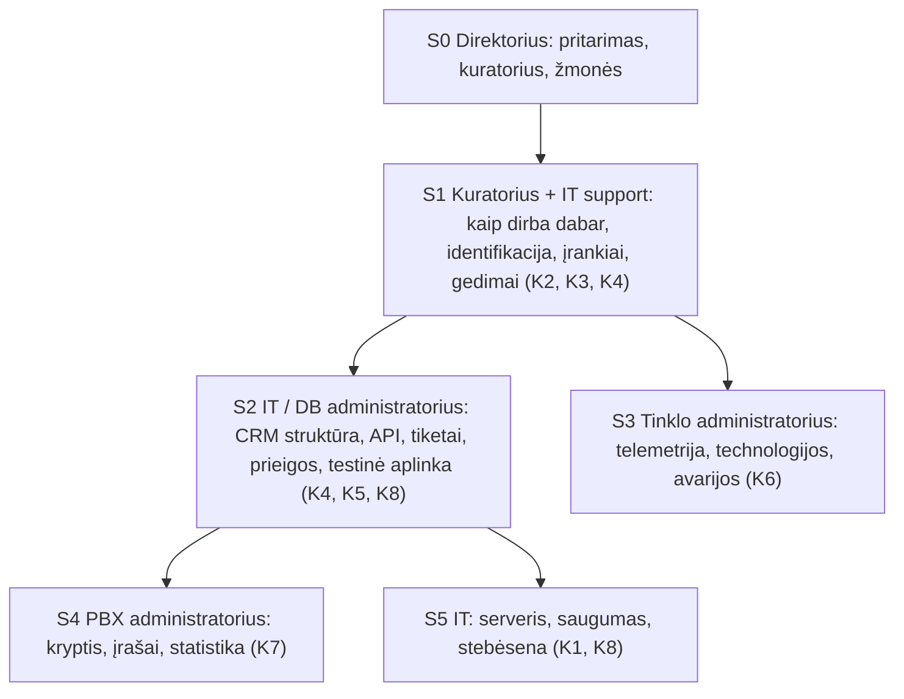
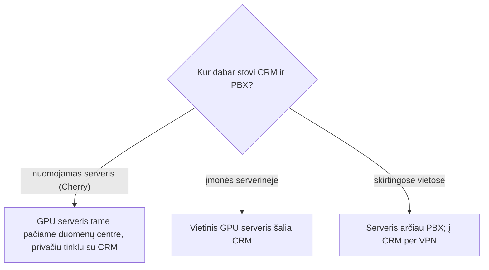
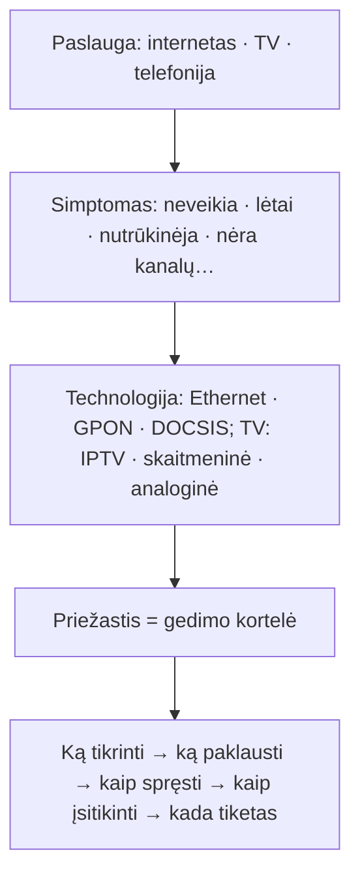
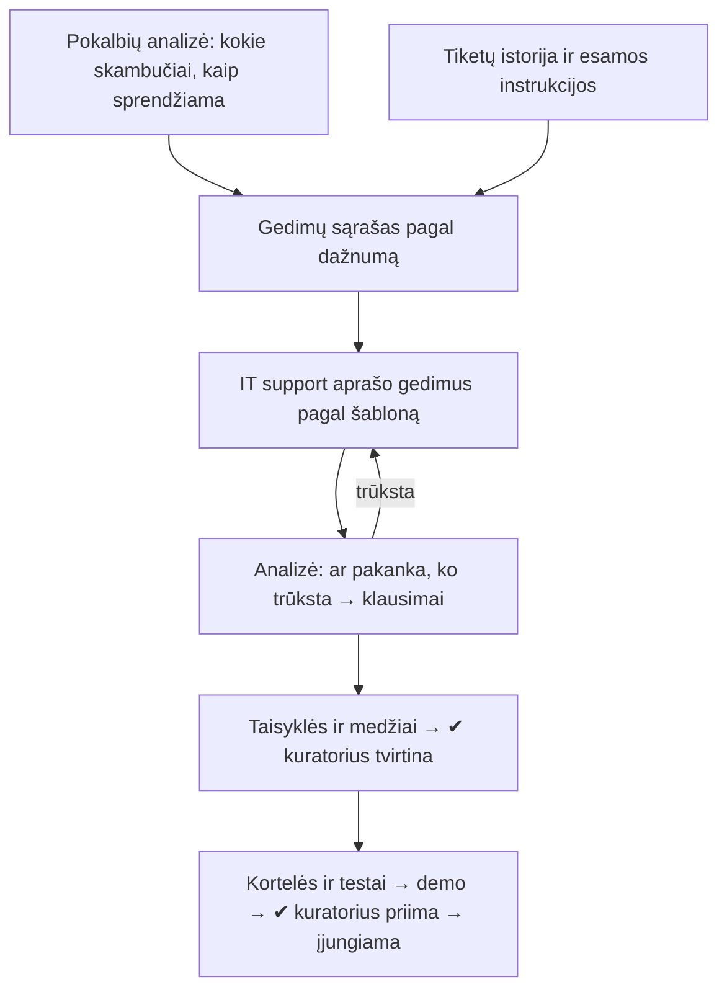
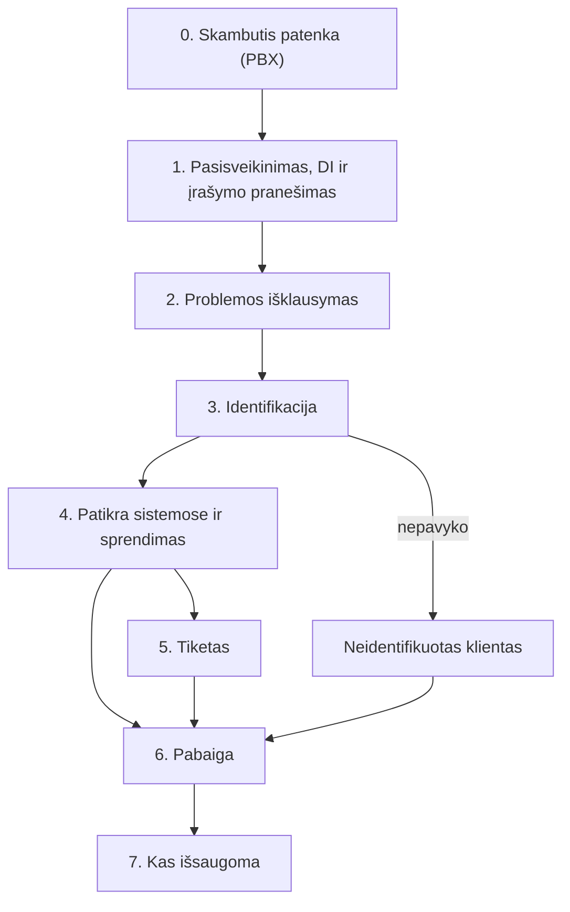
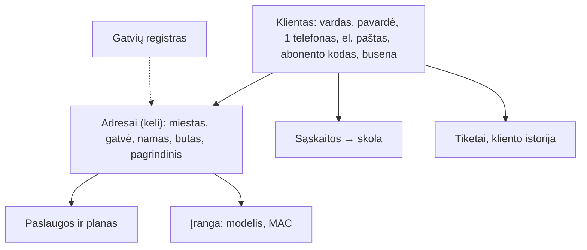
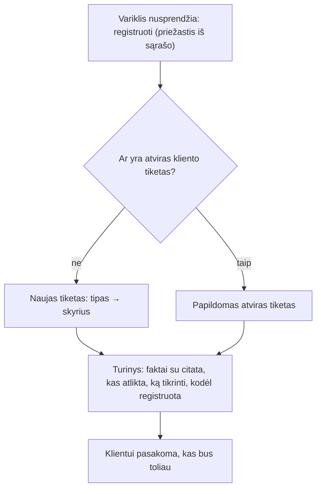

# Įgyvendinimo planas

Vidinis darbo planas: ką išsiaiškinti, kokių duomenų reikia, ką paruošiu, ko reikia iš įmonės ir
ką nuspręsti. Kryptys aptariamos po vieną: aprašymas → papildymai → sutartas sąrašas.

Pristatymas direktoriui: [docs/pristatymas](../pristatymas/README.md) ·
susitikimo lapas: [SUSITIKIMO_PLANAS.md](SUSITIKIMO_PLANAS.md).

## Kryptys

| # | Kryptis | Būsena |
|---|---|---|
| K1 | [Talpinimas ir modeliai](#k1-talpinimas-ir-modeliai) | sutarta |
| K2 | [Žinios (gedimai)](#k2-žinios-gedimai) | sutarta |
| K3 | [Agento eiga](#k3-agento-eiga): pasisveikinimas, tonas, identifikacija, informacija, tiketai, pabaiga | sutarta |
| K4 | [Identifikacija ir CRM duomenys](#k4-identifikacija-ir-crm-duomenys) | sutarta |
| K5 | [Tiketai](#k5-tiketai) | sutarta |
| K6 | Tinklo diagnostika | aptariama |
| K7 | Telefonija (PBX) | — |
| K8 | Architektūra, saugumas ir stebėsena | — |

Kiekviena kryptis: **ką išsiaiškinti · ko reikia iš įmonės · ką paruošiu · su kuo susitikti ·
ką nuspręsti**.

## Susitikimų seka

---

## K1. Talpinimas ir modeliai

**Principas:** agentas talpinamas ten, kur yra CRM ir PBX: Cherry Servers arba įmonės vietiniame
serveryje. Serverį administruoja įmonės darbuotojai, kurie tai daro dabar.

### Kas veikia serveryje

Kalbos atpažinimas (Whisper) · kalbos modelis (Gemma 4, vLLM) · balsas (Piper) · žinių paieška
(Qdrant + embeddings) · agentas ir jo DB (skambučių įrašai, sesijos) · stebėsena. GPU reikia tik
kalbos modeliui ir kalbos atpažinimui.

### GPU reikalavimai

Nepriklauso nuo gamintojo ar konkrečios plokštės — įmonė pagal juos įvertina, ką turi.

| Reikalavimas | Minimumas | Kodėl |
|---|---|---|
| **GPU atmintis (VRAM)** | **48 GB** vienoje plokštėje (arba 2× 24 GB) | kalbos modelis ~15–26 GB + kalbos atpažinimas ~3–5 GB + atmintis vienu metu vykstantiems pokalbiams |
| **Glaudinimas (kvantavimas)** | **INT8 / INT4** — būtina; **FP8** — pageidautina | INT4/INT8 veikia ir senesnėse plokštėse; FP8 greitesnis, bet reikia naujesnės kartos GPU |
| **Programinė įranga** | palaikoma vLLM: NVIDIA (CUDA) arba AMD (ROCm) | modelių paleidimo sistema |
| **Atminties pralaidumas** | kuo didesnis, tuo geriau | nuo jo priklauso, kaip greitai agentas atsako (delsa) |
| **Didesniam srautui** | 80 GB+ arba kelios plokštės | daugiau skambučių vienu metu |

### Kiti resursai

| Resursas | Pilotas | Kodėl |
|---|---|---|
| CPU | 16 branduolių | balsas, garso apdorojimas, žinių paieška, DB, agentas |
| RAM | 64 GB | modeliai, žinių paieška, DB, konteineriai |
| Diskas | 1 TB NVMe | modeliai, įrašai (~5 GB/mėn.), DB |
| OS | Ubuntu 24.04 LTS, Docker su GPU palaikymu | modelių ir agento diegimas |
| Tinklas | prieiga prie PBX (SIP) ir CRM API; VPN kūrėjui | maža delsa garsui, duomenys iš sistemų |
| Vieta | Lietuva / ES, dedikuotas serveris | BDAR, duomenų izoliacija |

Produkcijai: daugiau CPU ir RAM, rezervas. Jei skambučių vienu metu daug — daugiau GPU atminties.

### Ką išsiaiškinti

1. Ar įmonė turi savų serverių, ar nuomojasi (Cherry ar kitur)?
2. Kur stovi CRM, tiketų sistema, telemetrija ir PBX?
3. Kas administruoja serverius?
4. Kiek skambučių vienu metu būna piko metu po darbo valandų (PBX statistika)?
5. Ar kūrimo metu galima naudoti ES API su demo ar anonimizuotais duomenimis?
6. Kas vyksta, kai agentas neveikia? Siūloma: PBX grįžta į dabartinį kelią.

### Ką paruošiu

- resursų specifikaciją (lentelės aukščiau);
- diegimo aprašą: paslaugos, prievadai, tinklo schema;
- matavimus serveryje: delsą, lietuvių kalbą, kiek skambučių telpa vienu metu.

### Ko reikia iš įmonės

Atsakymų į klausimus 1–6, serverio (nuomojamo ar vietinio), administratoriaus kontakto ir prieigos
prie sistemų.

### Sprendimai

1. Kur talpinama: nuomojamas ar vietinis serveris?
2. Ar kūrimas vyksta per ES API, kol paruoštas serveris?
3. Ar rezervas reikalingas nuo piloto?

**Susitikimas:** S5 (IT). Klausimus 1–2 galima užduoti jau S0 su direktoriumi.

---

## K2. Žinios (gedimai)

### Kokių žinių reikia

| Žinių rūšis | Pavyzdžiai | Dabar agente |
|---|---|---|
| **Gedimai pagal paslaugą** | internetas neveikia / lėtai / nutrūkinėja; TV nerodo; telefonas neveikia | 7 kortelės, visos interneto „neveikia“ (Ethernet) |
| **Nuo technologijos nepriklausantys** | skola, avarija, atviras tiketas, Wi-Fi, kliento įrenginiai | ✅ yra |
| **Užklausos (ne gedimai)** | planas, kaina, sutartis, meistro vizitas → tiketas skyriui | dalinai |
| **Įranga** | routerių, ONT, modemų, TV dėžučių modeliai: lemputės, perkrovimas, Wi-Fi nustatymai | 10 aprašų |
| **Įmonės kalba** | terminai, planų pavadinimai, pasisveikinimas, kaip klientai vadina dalykus | demo žodynas |

### Iš kur surenkama

**Šablonas** (IT support procedūra): Simptomas · Patikrinti · Išsiaiškinti · Spręsti · Įsitikinti ·
Tiketas. Klausimai jame neprivalomi — aprašoma tai, kas žinoma. Šablonas bus atskiras dokumentas,
parengtas vėliau.

### Eilės tvarka

1. Dažniausi ir paprasčiausi: skola, avarija, internetas neveikia pagal technologiją.
2. Kliento įrenginiai: Wi-Fi, routeris, perkrovimas.
3. Lėtas ir nutrūkinėjantis internetas (sudėtingesnis).
4. TV, telefonija.
5. Užklausos → tiketai skyriams.

Tikslią tvarką nulems pokalbių analizė: kas dažniausia ir ką galima išspręsti telefonu.

### Ką išsiaiškinti

1. Kokios paslaugos ir technologijos, kiek klientų kiekvienoje?
2. Dažniausios skambučių priežastys po darbo valandų.
3. Kurias problemas IT support sprendžia telefonu, kurias perduoda meistrui, kurių neliečia?
4. Ar yra rašytinių instrukcijų, gedimų aprašų, tiketų istorija?
5. Kokia kliento įranga (modeliai) ir ar įmonė ją nuotoliniu būdu valdo?
6. Paslaugų priklausomybės (pvz., IPTV veikia per internetą).
7. Kas iš IT support aprašys gedimus ir kiek laiko tam skirs?

### Ką paruošiu

- gedimų aprašymo šabloną su užpildytais pavyzdžiais („pakibęs routeris“, skola, kitas MAC);
- pokalbių analizės ataskaitą (gedimai pagal dažnumą, kaip sprendžiama);
- analizę po kiekvieno aprašo: ko trūksta, klausimai;
- taisykles ir medžius tvirtinimui, kortelės ir testai;
- „Gedimų vadovą“ iš tų pačių aprašų.

### Ko reikia iš įmonės

Pokalbių įrašų, tiketų istorijos, esamų instrukcijų, IT support laiko aprašams ir kuratoriaus, kuris
tvirtina.

### Sprendimai

1. Nuo kurių gedimų pradedama (po analizės)?
2. Kas aprašo ir kas tvirtina?
3. Kokia aprašymo forma: dokumentas, lentelė ar forma?

**Susitikimas:** S1 (kuratorius + IT support).

---

## K3. Agento eiga

Per visą skambutį galioja tonas, kalba ir politika, tylos ir pertraukimų taisyklės.

| Etapas | Dabar agente | Sutarti |
|---|---|---|
| **0. Skambutis patenka** | demo per naršyklę | kada nukreipiama agentui (po darbo valandų, savaitgaliais, šventėmis, vėliau esant užimtumui); ar PBX iš anksto praneša apie DI; kas, jei klientas nenori kalbėti su DI (gyvo perdavimo nėra → perskambinimas darbo metu) |
| **1. Pasisveikinimas** | „Labas! Čia {įmonė}. Esu dirbtinio intelekto asistentas — padedu dėl interneto ir televizijos gedimų. Kuo galiu padėti?“ | **privaloma:** DI pranešimas (ES DI aktas, 50 str., nuo 2026-08-02) ir įrašymo pranešimas (BDAR). Kas sako įrašymo pranešimą (PBX ar agentas); tekstas („Labas“ / „Laba diena“, vardas, balso generavimas); balsas (Reginutė / Ingutė); ką agentas sprendžia |
| **2. Tonas, kalba, zona, politika** | „Jūs“, trumpi sakiniai, tik lietuviškai; miestas už zonos — pasakoma iškart | kitos kalbos (rusų, anglų): atsakyti ta kalba ar perskambinimas; aptarnaujamų vietovių sąrašas; ko nesakoma (kainos, nuolaidos, kompensacijos, meistro laikas); ką galima apie skolą; piktas ar keikiantis klientas |
| **3. Problemos išklausymas** | pirma problema, tada identifikacija; ne įmonės klausimas pasakomas; kelios problemos po vieną, vienas tiketas skambučiui | kokias temas priima (gedimai, užklausos, skola, sutartis); kurias sprendžia, kurias tik registruoja |
| **4. Identifikacija** | adresas pagal numerį → adresas → abonento kodas; adresas patvirtinamas, butą sako klientas; iki identifikacijos skola ir linija nematomos | ko pakanka; ar reikia papildomo klausimo (gimimo data, asmens ar įmonės kodas); ar gali skambinti ne savininkas; ką galima pasakyti neidentifikuotam (avarija adrese?). Duomenys — K4 |
| **5. Neidentifikuotas** | mandagi pabaiga, priežastis įraše, tiketo nėra | ar tiketas perskambinimui su numeriu („customer_not_found“); kas peržiūri; ką sakyti potencialiam klientui |
| **6. Tyla ir pertraukimai** | tyla → „ar dar ryšyje?“; užduoties metu laukiama ~35 s; po baigiamojo klausimo ~5 s → atsisveikinama; pertraukti galima; triukšmo filtrai | nutrūkęs ryšys → tiketas „skambutis nebaigtas“?; tylos laikai pagal realius pokalbius |
| **7. Patikra ir sprendimas** | pirma sistemos (skola, avarija, atviras tiketas, linija), tada klausimai; veiksmus atlieka tik variklis; be nepagrįstų pažadų | leidžiami nuotoliniai veiksmai ir nuo kada; avarijos atstatymo laikas ir jo šaltinis; skola: per kiek laiko po apmokėjimo įjungiama, ką sakyti savaitgalį |
| **8. Tiketai** | 16 tipų, 4 skyriai (techninis, tinklo, buhalterija, klientų aptarnavimas); atviras tiketas papildomas | tipų ir skyrių susiejimas su įmonės sistema; prioritetai savaitgalį; **ar matomi uždaryti tiketai** (pvz., 30 d.) pasikartojančiam gedimui; ar išspręstas skambutis registruojamas CRM kaip kontaktas. Sistema — K5 |
| **9. Pabaiga ir saugojimas** | apibendrinimas → „Ar dar kuo galiu padėti?“ → atsisveikinimas; kiekvienas skambutis išsaugomas agento DB (baigtis, priežastis, įrašas, nuorašas, „kodėl taip“) | tik agento DB ar ir CRM; įrašų ir nuorašų terminai (BDAR); kas mato stebėsenos puslapį |

**Susitikimas:** S1 (kuratorius + IT support). Teisės klausimai (DI pranešimas, įrašai, terminai) —
su duomenų apsaugos pareigūnu.

---

## K4. Identifikacija ir CRM duomenys

Iki identifikacijos agentas nemato nei skolos, nei linijos. Nuo duomenų ir jų ryšių priklauso, kiek
klausimų užduos agentas ir ar ras tinkamą liniją, kai klientas turi kelis adresus.

### Demo dabar

Demo ribos: vienas telefonas klientui, nėra sutarties lygio, nėra asmens ar įmonės kodo, viena CRM.

Agento identifikacija: adresas pagal numerį → adresas → abonento kodas. Adresas visada
patvirtinamas, butą sako klientas. Nustatymai — `knowledge/identification.yaml`.

### IT support įrankiai ir jų pasiekiamumas

Kiekvienam įrankiui, kurį IT support naudoja skambučio metu:

| Įrankis | Kam naudoja | Kur stovi (serveris / debesis) | Kaip pasiekiamas (API, DB, tik naršyklės sąsaja) | Atsako laikas | Kas administruoja |
|---|---|---|---|---|---|
| CRM | … | … | … | … | … |
| sąskaitos | … | … | … | … | … |
| telemetrija / stebėsena | … | … | … | … | … |
| tiketai | … | … | … | … | … |
| kiti | … | … | … | … | … |

Paprašyti: **DB schemų** (ar sistemų duomenų aprašų) ir **talpinimo vietų** (tinklo schemos: kur
stovi kiekviena sistema). Pagal tai parenkamas greičiausias ir saugiausias kelias:

| Kelias | Kada |
|---|---|
| esamas API | jei yra ir greitai atsako |
| DB vaizdas / tik skaitymo kopija | jei API nėra arba lėtas |
| sinchronizuota kopija agento DB | jei sistema toli ar lėta; tik duomenims, kurie keičiasi retai (adresai, įranga) |
| tik naršyklės sąsaja | netinka — reikia API arba DB vaizdo |

### Kaip identifikuoja dabar (IT support)

1. Ko klausia pirmiausia: telefono, adreso, vardo, sutarties numerio, abonento kodo?
2. Kaip patikrina, kad skambina tikras klientas? Ar užduoda papildomą klausimą?
3. Ką daro, kai skambina ne sutarties savininkas (šeimos narys, nuomininkas, įmonės darbuotojas)?
4. Ką daro, kai klientas turi kelis adresus ar sutartis?
5. Kokiais įrankiais naudojasi ir kas atidaroma pirmiausia?
6. Kur dažniausiai būna sunkumų, kiek laiko užtrunka identifikacija?

### Telefono numeris

| Klausimas | Kodėl svarbu |
|---|---|
| Ar klientas gali turėti **kelis numerius**? | daugiau numerių → dažniau atpažįstama iš karto |
| Ar **tas pats numeris gali būti keliems klientams** (šeima, įmonė, buvęs savininkas)? | tada agentas siūlo kelis adresus arba klausia adreso |
| Ar numeris imamas **tik iš kliento kortelės**, ar ir **iš skambučių istorijos**? | istorija padeda, kai skambinama iš kito numerio; reikia BDAR pagrindo |
| Numerių formatas (+370 / 8…), ar tvarkingi? | paieškos tikslumas |
| Ar PBX perduoda numerį? Kas, jei paslėptas? | paslėptas → identifikacija pagal adresą |

### Papildomi identifikatoriai

| Identifikatorius | Klausimas | Pastaba |
|---|---|---|
| **Adresas** | atskiri laukai ar vienas tekstas? ar yra adresų registras? | pagrindinis būdas, jau veikia |
| **Abonento / sutarties kodas** | ar spausdinamas sąskaitoje? formatas? | jau veikia demo |
| **Įmonės kodas** | ar saugomas juridiniams klientams? | verslo klientams patogiausias |
| **Gimimo data** | ar saugoma? | papildomam patikrinimui; asmens duomenys |
| **Asmens kodas** | ar saugomas? | **jautrus**: per telefoną geriau nenaudoti arba tik dalį; reikia DAP nuomonės |
| **Vardas, pavardė** | — | tik patvirtinimui, ne paieškai |

Kiek duomenų pakanka pagal riziką: **avarijos informacija** — adresas; **skola, linija, tiketas** —
adresas ir patvirtinimas; **sutarties pakeitimai** — agentas nedaro, tik registruoja.

### CRM struktūra (DB administratorius)

1. **Kiek sistemų**: viena CRM ar duomenys keliose (klientai, sąskaitos, įranga)? Kas iš kur imama?
2. **Ryšiai**: klientas → sutartys → paslaugų adresai → paslaugos → įranga (MAC, modelis) →
   technologija.
3. **Unikalūs identifikatoriai**: kliento ID, sutarties nr., abonento kodas, paslaugos taško ID.
4. **Technologija**: ar CRM nurodo technologiją adresu, ar ją reikia atpažinti iš plano pavadinimo?
5. **Skola**: kur saugoma; balansas, terminas, sustabdymo būsena.
6. **Prieiga**: API, DB vaizdas ar kita; testinė aplinka ir tik skaitymo paskyra.
7. **BDAR**: kokius laukus agentui matyti draudžiama?

### Ką paruošiu

- duomenų žemėlapį: kokių laukų agentui reikia, iš kurios sistemos, kokiu raktu ir keliu;
- identifikacijos taisykles pagal sutartą duomenų kiekį;
- adapterius kiekvienai sistemai (K8);
- testus su testinės aplinkos duomenimis.

### Ko reikia iš įmonės

IT support paaiškinimo ir įrankių parodymo; DB schemų ir talpinimo vietų; testinės aplinkos ir tik
skaitymo paskyros; DAP sprendimo dėl identifikatorių.

### Sprendimai

1. Kokie identifikatoriai naudojami ir kokia tvarka?
2. Ko pakanka kiekvienam veiksmui?
3. Ar galima naudoti skambučių istoriją numeriui atpažinti?
4. Ar gali skambinti ne sutarties savininkas?
5. Koks kelias į kiekvieną sistemą (API, DB vaizdas, kopija)?

**Susitikimai:** S1 (IT support: kaip identifikuoja, įrankiai) · S2 (DB administratorius: schemos,
talpinimas, prieiga).

---

## K5. Tiketai

### Demo dabar

- **Kada registruojama:** tik dėl priežasties iš `knowledge/registracija.yaml` (visi žingsniai
  atlikti, bet gedimas liko; telefonu nepataisoma; gedimas neaiškus; tinklo gedimas; klientas
  nenori tęsti…). Modelio žodis „užregistruosiu“ tiketo nesukuria.
- **Tipai:** 16 tipų, 4 skyriai (techninis, tinklo, buhalterija, klientų aptarnavimas).
- **Masinis gedimas:** vienas tinklo tiketas, ne po vieną kiekvienam klientui.
- **Per skambutį** registruojamas vienas tiketas.

### Procesas (kuratorius, IT support)

1. Įmonės tiketų tipai ir skyriai; susiejimas su agento tipais.
2. Prioritetai: kas skubu savaitgalį (verslo klientas, visas namas be ryšio…)?
3. Masinių gedimų registras: kaip klientai susiejami su avarija?
4. Ar agentas mato **uždarytus** kliento tiketus (pvz., 30 d.) ir kaip jie išspręsti? —
   pasikartojantis gedimas → iškart meistras.
5. Kaip dabar žymimi pakartotiniai skambučiai dėl to paties gedimo?
6. Kas ir kada peržiūri savaitgalio tiketus?
7. Ar klientui sakomas tiketo numeris; ar siunčiama SMS ar el. laiškas?
8. Ar išspręstas skambutis be tiketo registruojamas CRM kaip kontaktas?
9. Ar skubiems atvejams reikia pranešimo atsakingam žmogui (sutariama kūrimo metu)?
10. Kaip atrodo geras tiketas (pavyzdžiai)?

### Techninis lygis (IT / DB administratorius, K8)

1. Tiketų sistema (CRM dalis ar atskira), API, privalomi laukai.
2. Testinė aplinka tiketams kurti.
3. Kas, jei sistema neatsako — siūloma: tiketas išsaugomas agento DB ir užregistruojamas vėliau.

### Ką paruošiu

Tipų ir skyrių susiejimo lentelę; tiketo turinio šabloną; tiketų adapterį ir eilę, kai sistema
neatsako; testus testinėje aplinkoje; tiketų peržiūrą su kuratoriumi.

### Ko reikia iš įmonės

Tipų, skyrių ir prioritetų sąrašo; gerų tiketų pavyzdžių; žmogaus, kuris peržiūri savaitgalio
tiketus; sistemos aprašo, API ir testinės aplinkos.

### Sprendimai

1. Tipų ir skyrių susiejimas, prioritetai.
2. Ar agentas mato uždarytus tiketus ir per kiek laiko atgal?
3. Ar klientui sakomas tiketo numeris ir siunčiamas pranešimas?
4. Ar išspręsti skambučiai registruojami CRM?

**Susitikimai:** S1 (procesas) · S2 (techninis lygis).
