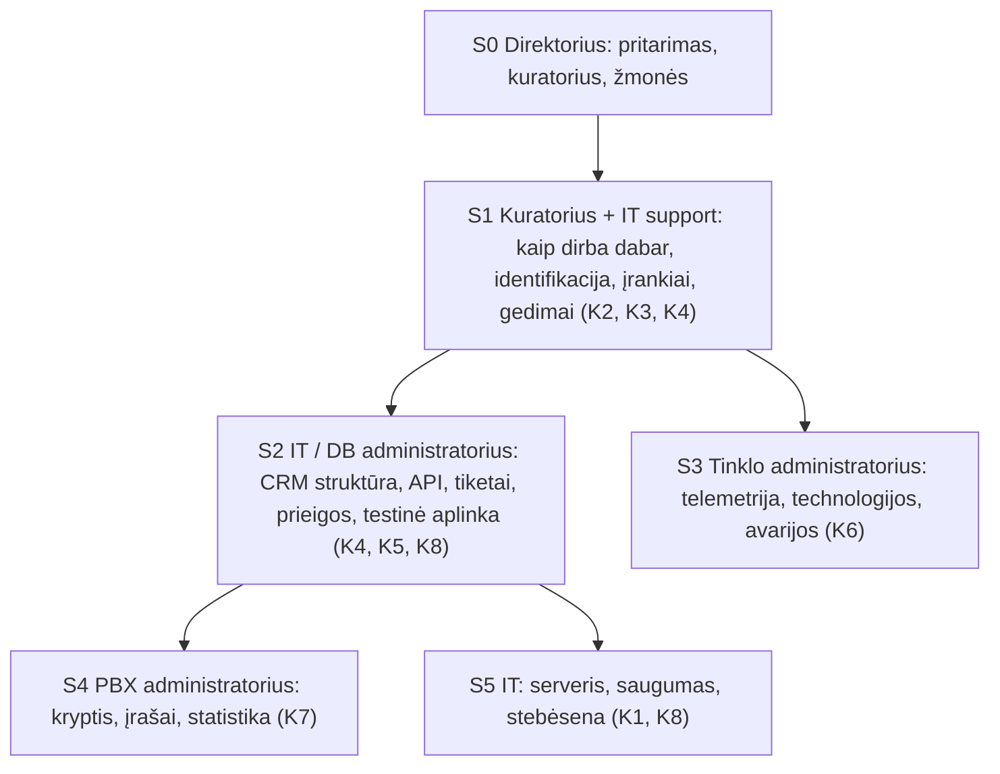
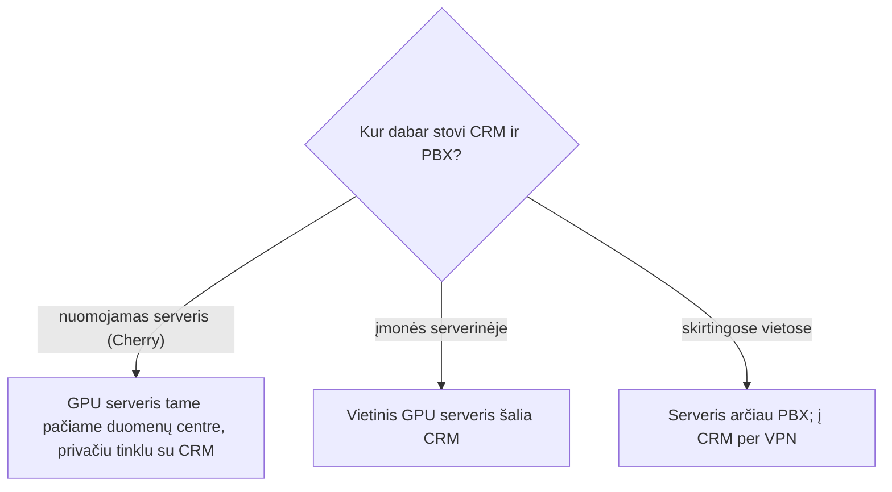

# Įgyvendinimo planas

Vidinis darbo planas: ką išsiaiškinti, kokių duomenų reikia, ką paruošiu, ko reikia iš įmonės ir
ką nuspręsti. Kryptys aptariamos po vieną: aprašymas → papildymai → sutartas sąrašas.

Pristatymas direktoriui: [docs/pristatymas](../pristatymas/README.md) ·
susitikimo lapas: [SUSITIKIMO_PLANAS.md](SUSITIKIMO_PLANAS.md).

## Kryptys

| # | Kryptis | Būsena |
|---|---|---|
| K1 | [Talpinimas ir modeliai](#k1-talpinimas-ir-modeliai) | sutarta |
| K2 | Žinios (gedimai) | aptariama |
| K3 | Agento eiga: pasisveikinimas, tonas, identifikacija, informacija, tiketai, pabaiga | — |
| K4 | Identifikacija ir CRM duomenys | — |
| K5 | Tiketai | — |
| K6 | Tinklo diagnostika | — |
| K7 | Telefonija (PBX) | — |
| K8 | Architektūra, saugumas ir stebėsena | — |

Kiekviena kryptis: **ką išsiaiškinti · ko reikia iš įmonės · ką paruošiu · su kuo susitikti ·
ką nuspręsti**.

## Susitikimų seka

---

## K1. Talpinimas ir modeliai

**Principas:** agentas talpinamas ten, kur yra CRM ir PBX: Cherry Servers arba įmonės vietiniame
serveryje. Serverį administruoja įmonės darbuotojai, kurie tai daro dabar.

### Kas veikia serveryje

Kalbos atpažinimas (Whisper) · kalbos modelis (Gemma 4, vLLM) · balsas (Piper) · žinių paieška
(Qdrant + embeddings) · agentas ir jo DB (skambučių įrašai, sesijos) · stebėsena. GPU reikia tik
kalbos modeliui ir kalbos atpažinimui.

### GPU reikalavimai

Nepriklauso nuo gamintojo ar konkrečios plokštės — įmonė pagal juos įvertina, ką turi.

| Reikalavimas | Minimumas | Kodėl |
|---|---|---|
| **GPU atmintis (VRAM)** | **48 GB** vienoje plokštėje (arba 2× 24 GB) | kalbos modelis ~15–26 GB + kalbos atpažinimas ~3–5 GB + atmintis vienu metu vykstantiems pokalbiams |
| **Glaudinimas (kvantavimas)** | **INT8 / INT4** — būtina; **FP8** — pageidautina | INT4/INT8 veikia ir senesnėse plokštėse; FP8 greitesnis, bet reikia naujesnės kartos GPU |
| **Programinė įranga** | palaikoma vLLM: NVIDIA (CUDA) arba AMD (ROCm) | modelių paleidimo sistema |
| **Atminties pralaidumas** | kuo didesnis, tuo geriau | nuo jo priklauso, kaip greitai agentas atsako (delsa) |
| **Didesniam srautui** | 80 GB+ arba kelios plokštės | daugiau skambučių vienu metu |

### Kiti resursai

| Resursas | Pilotas | Kodėl |
|---|---|---|
| CPU | 16 branduolių | balsas, garso apdorojimas, žinių paieška, DB, agentas |
| RAM | 64 GB | modeliai, žinių paieška, DB, konteineriai |
| Diskas | 1 TB NVMe | modeliai, įrašai (~5 GB/mėn.), DB |
| OS | Ubuntu 24.04 LTS, Docker su GPU palaikymu | modelių ir agento diegimas |
| Tinklas | prieiga prie PBX (SIP) ir CRM API; VPN kūrėjui | maža delsa garsui, duomenys iš sistemų |
| Vieta | Lietuva / ES, dedikuotas serveris | BDAR, duomenų izoliacija |

Produkcijai: daugiau CPU ir RAM, rezervas. Jei skambučių vienu metu daug — daugiau GPU atminties.

### Ką išsiaiškinti

1. Ar įmonė turi savų serverių, ar nuomojasi (Cherry ar kitur)?
2. Kur stovi CRM, tiketų sistema, telemetrija ir PBX?
3. Kas administruoja serverius?
4. Kiek skambučių vienu metu būna piko metu po darbo valandų (PBX statistika)?
5. Ar kūrimo metu galima naudoti ES API su demo ar anonimizuotais duomenimis?
6. Kas vyksta, kai agentas neveikia? Siūloma: PBX grįžta į dabartinį kelią.

### Ką paruošiu

- resursų specifikaciją (lentelės aukščiau);
- diegimo aprašą: paslaugos, prievadai, tinklo schema;
- matavimus serveryje: delsą, lietuvių kalbą, kiek skambučių telpa vienu metu.

### Ko reikia iš įmonės

Atsakymų į klausimus 1–6, serverio (nuomojamo ar vietinio), administratoriaus kontakto ir prieigos
prie sistemų.

### Sprendimai

1. Kur talpinama: nuomojamas ar vietinis serveris?
2. Ar kūrimas vyksta per ES API, kol paruoštas serveris?
3. Ar rezervas reikalingas nuo piloto?

**Susitikimas:** S5 (IT). Klausimus 1–2 galima užduoti jau S0 su direktoriumi.
