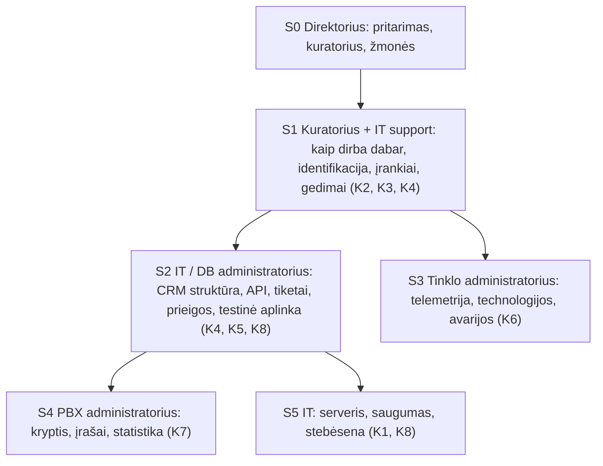
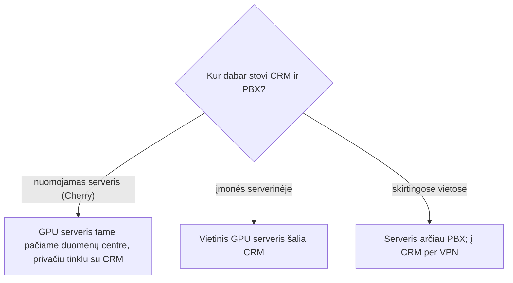
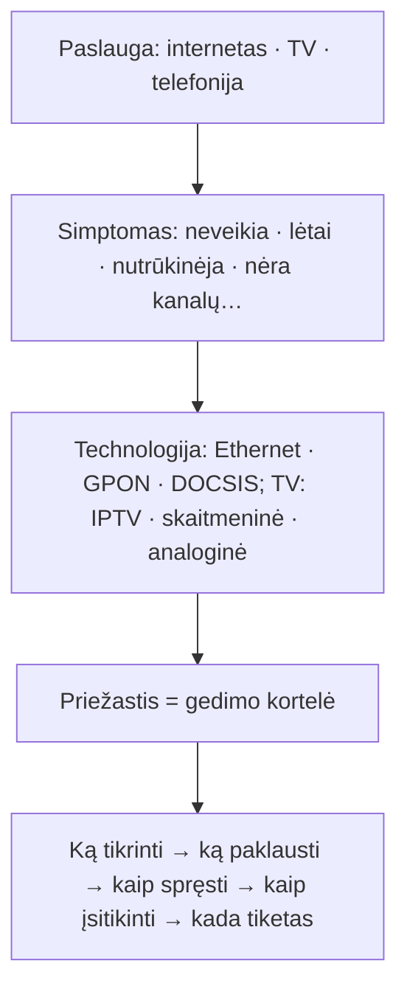
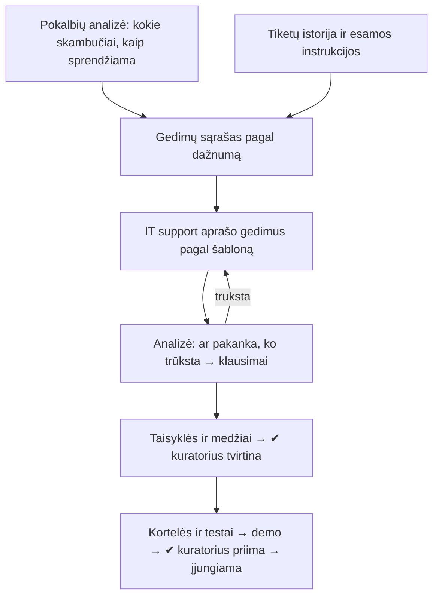
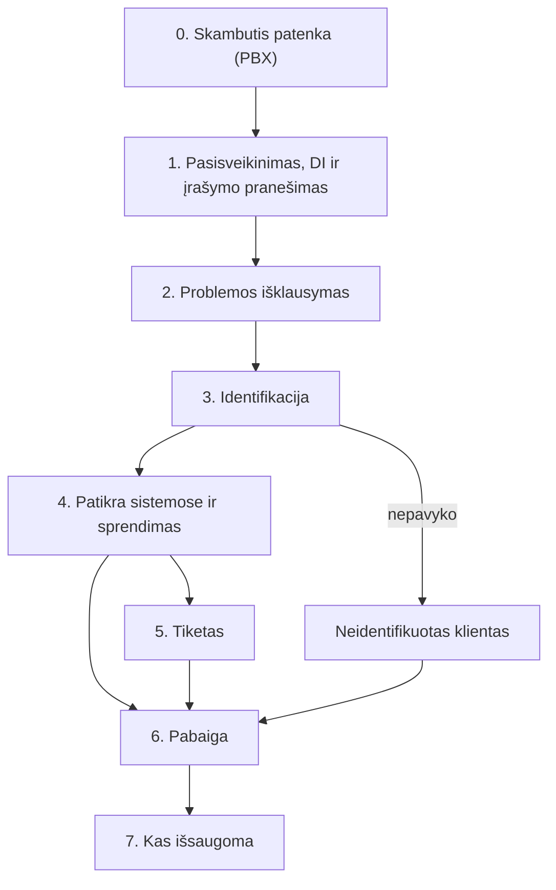

# Įgyvendinimo planas

Vidinis darbo planas: ką išsiaiškinti, kokių duomenų reikia, ką paruošiu, ko reikia iš įmonės ir
ką nuspręsti. Kryptys aptariamos po vieną: aprašymas → papildymai → sutartas sąrašas.

Pristatymas direktoriui: [docs/pristatymas](../pristatymas/README.md) ·
susitikimo lapas: [SUSITIKIMO_PLANAS.md](SUSITIKIMO_PLANAS.md).

## Kryptys

| # | Kryptis | Būsena |
|---|---|---|
| K1 | [Talpinimas ir modeliai](#k1-talpinimas-ir-modeliai) | sutarta |
| K2 | [Žinios (gedimai)](#k2-žinios-gedimai) | sutarta |
| K3 | [Agento eiga](#k3-agento-eiga): pasisveikinimas, tonas, identifikacija, informacija, tiketai, pabaiga | sutarta |
| K4 | Identifikacija ir CRM duomenys | aptariama |
| K5 | Tiketai | — |
| K6 | Tinklo diagnostika | — |
| K7 | Telefonija (PBX) | — |
| K8 | Architektūra, saugumas ir stebėsena | — |

Kiekviena kryptis: **ką išsiaiškinti · ko reikia iš įmonės · ką paruošiu · su kuo susitikti ·
ką nuspręsti**.

## Susitikimų seka

---

## K1. Talpinimas ir modeliai

**Principas:** agentas talpinamas ten, kur yra CRM ir PBX: Cherry Servers arba įmonės vietiniame
serveryje. Serverį administruoja įmonės darbuotojai, kurie tai daro dabar.

### Kas veikia serveryje

Kalbos atpažinimas (Whisper) · kalbos modelis (Gemma 4, vLLM) · balsas (Piper) · žinių paieška
(Qdrant + embeddings) · agentas ir jo DB (skambučių įrašai, sesijos) · stebėsena. GPU reikia tik
kalbos modeliui ir kalbos atpažinimui.

### GPU reikalavimai

Nepriklauso nuo gamintojo ar konkrečios plokštės — įmonė pagal juos įvertina, ką turi.

| Reikalavimas | Minimumas | Kodėl |
|---|---|---|
| **GPU atmintis (VRAM)** | **48 GB** vienoje plokštėje (arba 2× 24 GB) | kalbos modelis ~15–26 GB + kalbos atpažinimas ~3–5 GB + atmintis vienu metu vykstantiems pokalbiams |
| **Glaudinimas (kvantavimas)** | **INT8 / INT4** — būtina; **FP8** — pageidautina | INT4/INT8 veikia ir senesnėse plokštėse; FP8 greitesnis, bet reikia naujesnės kartos GPU |
| **Programinė įranga** | palaikoma vLLM: NVIDIA (CUDA) arba AMD (ROCm) | modelių paleidimo sistema |
| **Atminties pralaidumas** | kuo didesnis, tuo geriau | nuo jo priklauso, kaip greitai agentas atsako (delsa) |
| **Didesniam srautui** | 80 GB+ arba kelios plokštės | daugiau skambučių vienu metu |

### Kiti resursai

| Resursas | Pilotas | Kodėl |
|---|---|---|
| CPU | 16 branduolių | balsas, garso apdorojimas, žinių paieška, DB, agentas |
| RAM | 64 GB | modeliai, žinių paieška, DB, konteineriai |
| Diskas | 1 TB NVMe | modeliai, įrašai (~5 GB/mėn.), DB |
| OS | Ubuntu 24.04 LTS, Docker su GPU palaikymu | modelių ir agento diegimas |
| Tinklas | prieiga prie PBX (SIP) ir CRM API; VPN kūrėjui | maža delsa garsui, duomenys iš sistemų |
| Vieta | Lietuva / ES, dedikuotas serveris | BDAR, duomenų izoliacija |

Produkcijai: daugiau CPU ir RAM, rezervas. Jei skambučių vienu metu daug — daugiau GPU atminties.

### Ką išsiaiškinti

1. Ar įmonė turi savų serverių, ar nuomojasi (Cherry ar kitur)?
2. Kur stovi CRM, tiketų sistema, telemetrija ir PBX?
3. Kas administruoja serverius?
4. Kiek skambučių vienu metu būna piko metu po darbo valandų (PBX statistika)?
5. Ar kūrimo metu galima naudoti ES API su demo ar anonimizuotais duomenimis?
6. Kas vyksta, kai agentas neveikia? Siūloma: PBX grįžta į dabartinį kelią.

### Ką paruošiu

- resursų specifikaciją (lentelės aukščiau);
- diegimo aprašą: paslaugos, prievadai, tinklo schema;
- matavimus serveryje: delsą, lietuvių kalbą, kiek skambučių telpa vienu metu.

### Ko reikia iš įmonės

Atsakymų į klausimus 1–6, serverio (nuomojamo ar vietinio), administratoriaus kontakto ir prieigos
prie sistemų.

### Sprendimai

1. Kur talpinama: nuomojamas ar vietinis serveris?
2. Ar kūrimas vyksta per ES API, kol paruoštas serveris?
3. Ar rezervas reikalingas nuo piloto?

**Susitikimas:** S5 (IT). Klausimus 1–2 galima užduoti jau S0 su direktoriumi.

---

## K2. Žinios (gedimai)

### Kokių žinių reikia

| Žinių rūšis | Pavyzdžiai | Dabar agente |
|---|---|---|
| **Gedimai pagal paslaugą** | internetas neveikia / lėtai / nutrūkinėja; TV nerodo; telefonas neveikia | 7 kortelės, visos interneto „neveikia“ (Ethernet) |
| **Nuo technologijos nepriklausantys** | skola, avarija, atviras tiketas, Wi-Fi, kliento įrenginiai | ✅ yra |
| **Užklausos (ne gedimai)** | planas, kaina, sutartis, meistro vizitas → tiketas skyriui | dalinai |
| **Įranga** | routerių, ONT, modemų, TV dėžučių modeliai: lemputės, perkrovimas, Wi-Fi nustatymai | 10 aprašų |
| **Įmonės kalba** | terminai, planų pavadinimai, pasisveikinimas, kaip klientai vadina dalykus | demo žodynas |

### Iš kur surenkama

**Šablonas** (IT support procedūra): Simptomas · Patikrinti · Išsiaiškinti · Spręsti · Įsitikinti ·
Tiketas. Klausimai jame neprivalomi — aprašoma tai, kas žinoma. Šablonas bus atskiras dokumentas,
parengtas vėliau.

### Eilės tvarka

1. Dažniausi ir paprasčiausi: skola, avarija, internetas neveikia pagal technologiją.
2. Kliento įrenginiai: Wi-Fi, routeris, perkrovimas.
3. Lėtas ir nutrūkinėjantis internetas (sudėtingesnis).
4. TV, telefonija.
5. Užklausos → tiketai skyriams.

Tikslią tvarką nulems pokalbių analizė: kas dažniausia ir ką galima išspręsti telefonu.

### Ką išsiaiškinti

1. Kokios paslaugos ir technologijos, kiek klientų kiekvienoje?
2. Dažniausios skambučių priežastys po darbo valandų.
3. Kurias problemas IT support sprendžia telefonu, kurias perduoda meistrui, kurių neliečia?
4. Ar yra rašytinių instrukcijų, gedimų aprašų, tiketų istorija?
5. Kokia kliento įranga (modeliai) ir ar įmonė ją nuotoliniu būdu valdo?
6. Paslaugų priklausomybės (pvz., IPTV veikia per internetą).
7. Kas iš IT support aprašys gedimus ir kiek laiko tam skirs?

### Ką paruošiu

- gedimų aprašymo šabloną su užpildytais pavyzdžiais („pakibęs routeris“, skola, kitas MAC);
- pokalbių analizės ataskaitą (gedimai pagal dažnumą, kaip sprendžiama);
- analizę po kiekvieno aprašo: ko trūksta, klausimai;
- taisykles ir medžius tvirtinimui, kortelės ir testai;
- „Gedimų vadovą“ iš tų pačių aprašų.

### Ko reikia iš įmonės

Pokalbių įrašų, tiketų istorijos, esamų instrukcijų, IT support laiko aprašams ir kuratoriaus, kuris
tvirtina.

### Sprendimai

1. Nuo kurių gedimų pradedama (po analizės)?
2. Kas aprašo ir kas tvirtina?
3. Kokia aprašymo forma: dokumentas, lentelė ar forma?

**Susitikimas:** S1 (kuratorius + IT support).

---

## K3. Agento eiga

Per visą skambutį galioja tonas, kalba ir politika, tylos ir pertraukimų taisyklės.

| Etapas | Dabar agente | Sutarti |
|---|---|---|
| **0. Skambutis patenka** | demo per naršyklę | kada nukreipiama agentui (po darbo valandų, savaitgaliais, šventėmis, vėliau esant užimtumui); ar PBX iš anksto praneša apie DI; kas, jei klientas nenori kalbėti su DI (gyvo perdavimo nėra → perskambinimas darbo metu) |
| **1. Pasisveikinimas** | „Labas! Čia {įmonė}. Esu dirbtinio intelekto asistentas — padedu dėl interneto ir televizijos gedimų. Kuo galiu padėti?“ | **privaloma:** DI pranešimas (ES DI aktas, 50 str., nuo 2026-08-02) ir įrašymo pranešimas (BDAR). Kas sako įrašymo pranešimą (PBX ar agentas); tekstas („Labas“ / „Laba diena“, vardas, balso generavimas); balsas (Reginutė / Ingutė); ką agentas sprendžia |
| **2. Tonas, kalba, zona, politika** | „Jūs“, trumpi sakiniai, tik lietuviškai; miestas už zonos — pasakoma iškart | kitos kalbos (rusų, anglų): atsakyti ta kalba ar perskambinimas; aptarnaujamų vietovių sąrašas; ko nesakoma (kainos, nuolaidos, kompensacijos, meistro laikas); ką galima apie skolą; piktas ar keikiantis klientas |
| **3. Problemos išklausymas** | pirma problema, tada identifikacija; ne įmonės klausimas pasakomas; kelios problemos po vieną, vienas tiketas skambučiui | kokias temas priima (gedimai, užklausos, skola, sutartis); kurias sprendžia, kurias tik registruoja |
| **4. Identifikacija** | adresas pagal numerį → adresas → abonento kodas; adresas patvirtinamas, butą sako klientas; iki identifikacijos skola ir linija nematomos | ko pakanka; ar reikia papildomo klausimo (gimimo data, asmens ar įmonės kodas); ar gali skambinti ne savininkas; ką galima pasakyti neidentifikuotam (avarija adrese?). Duomenys — K4 |
| **5. Neidentifikuotas** | mandagi pabaiga, priežastis įraše, tiketo nėra | ar tiketas perskambinimui su numeriu („customer_not_found“); kas peržiūri; ką sakyti potencialiam klientui |
| **6. Tyla ir pertraukimai** | tyla → „ar dar ryšyje?“; užduoties metu laukiama ~35 s; po baigiamojo klausimo ~5 s → atsisveikinama; pertraukti galima; triukšmo filtrai | nutrūkęs ryšys → tiketas „skambutis nebaigtas“?; tylos laikai pagal realius pokalbius |
| **7. Patikra ir sprendimas** | pirma sistemos (skola, avarija, atviras tiketas, linija), tada klausimai; veiksmus atlieka tik variklis; be nepagrįstų pažadų | leidžiami nuotoliniai veiksmai ir nuo kada; avarijos atstatymo laikas ir jo šaltinis; skola: per kiek laiko po apmokėjimo įjungiama, ką sakyti savaitgalį |
| **8. Tiketai** | 16 tipų, 4 skyriai (techninis, tinklo, buhalterija, klientų aptarnavimas); atviras tiketas papildomas | tipų ir skyrių susiejimas su įmonės sistema; prioritetai savaitgalį; **ar matomi uždaryti tiketai** (pvz., 30 d.) pasikartojančiam gedimui; ar išspręstas skambutis registruojamas CRM kaip kontaktas. Sistema — K5 |
| **9. Pabaiga ir saugojimas** | apibendrinimas → „Ar dar kuo galiu padėti?“ → atsisveikinimas; kiekvienas skambutis išsaugomas agento DB (baigtis, priežastis, įrašas, nuorašas, „kodėl taip“) | tik agento DB ar ir CRM; įrašų ir nuorašų terminai (BDAR); kas mato stebėsenos puslapį |

**Susitikimas:** S1 (kuratorius + IT support). Teisės klausimai (DI pranešimas, įrašai, terminai) —
su duomenų apsaugos pareigūnu.
