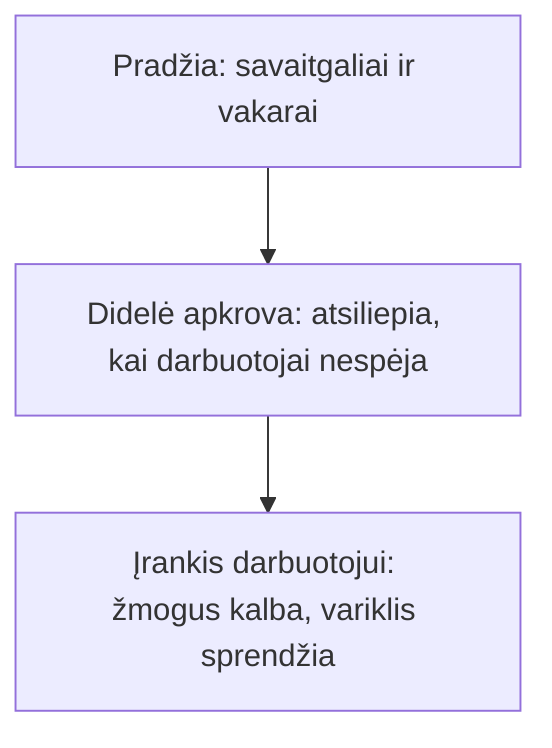

# 1. Nauda įmonei

[← Turinys](README.md) · [2. Sprendimai →](2-sprendimai.md)

---

| Dabar | Su agentu |
|---|---|
| savaitgalį iki 20 val. dirba IT support | savaitgaliais ir vakarais atsiliepia agentas |
| po darbo valandų skambutis lieka praleistas | atsiliepiama į kiekvieną skambutį |
| užimta linija: skambutis registruojamas kaip praleistas, perskambinama | klientas iškart informuojamas arba problema sprendžiama |
| informacija perduodama žodžiu ar raštu | darbo dienos laukia paruošti tiketai: faktai, kas atlikta, ką tikrinti |

## Penkios naudos

| # | Nauda | Ką tai reiškia |
|---|---|---|
| ① | **Be IT support pamainos savaitgaliais ir po darbo valandų** | agentas atlieka darbą, kurį dabar atlieka žmogus: išklauso, patikrina, išsprendžia arba užregistruoja, atrenka, kur iš tikrųjų reikia meistro |
| ② | **Atsiliepiama į kiekvieną skambutį** | dabar dalis skambučių lieka praleisti. Agentas atsiliepia visada, todėl klientas informaciją gauna greičiau ir yra labiau patenkintas |
| ③ | **Visada vienodas aptarnavimas** | agentas nepavargsta ir neturi blogos nuotaikos; su piktu klientu kalba mandagiai ir laikosi tų pačių taisyklių |
| ④ | **Žinios tampa įmonės turtu** | gedimai aprašyti aiškiai: kaip atpažinti ir kaip spręsti. Iš tų pačių aprašų gaunamas **„Gedimų vadovas“** naujiems darbuotojams apmokyti. Žinios neišeina kartu su darbuotoju |
| ⑤ | **Vėliau: įrankis darbuotojui** | žmogus kalba su klientu, o sprendimus siūlo variklis. Aptarnauti gali darbuotojas be gilių IT žinių |

## Kaip plečiama

Agentas kuriamas taip, kad galėtų dirbti visada. Pradedama nuo laiko, kai žmonių nėra.

## Skaičiai

Tikslių skaičių (kiek skambučių po darbo valandų, kiek praleidžiama, kokia dalis išsprendžiama
telefonu) šiandien neturime. Juos duos:

- **pokalbių analizė** pirmame etape ([8. Planas](8-planas.md)): kiek ir kokių skambučių, kaip jie
  sprendžiami dabar;
- **PBX statistika**: kiek skambučių po darbo valandų ir kiek praleista;
- **pilotas**: stebėsenos puslapis kiekvieno skambučio baigtį skaičiuoja automatiškai.

---

[← Turinys](README.md) · [2. Sprendimai →](2-sprendimai.md)
