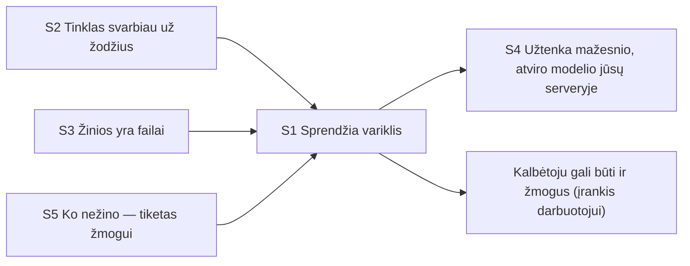
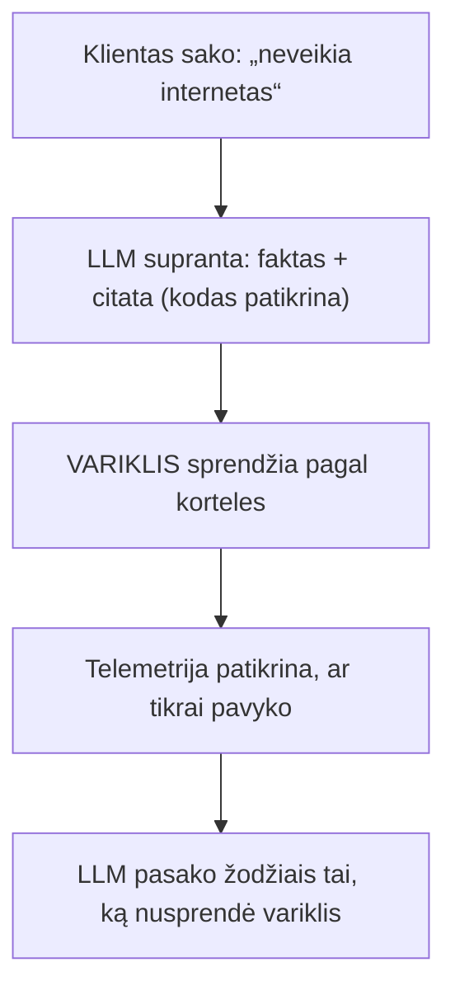

# 2. Priimti sprendimai ir kodėl

[← 1. Nauda](1-nauda.md) · [Turinys](README.md) · [3. Kaip veikia →](3-kaip-veikia.md)

---

Penki sprendimai, kurie skiria šį agentą nuo įprasto pokalbių roboto. Kiekvienas aprašytas taip:
**sprendimas → kodėl → duomenys → ką duoda įmonei**.

## S1. Sprendžia variklis, kalbos modelis tik supranta ir kalba

| | |
|---|---|
| **Sprendimas** | Ką daryti, sprendžia **variklis** pagal gedimų taisykles ir sistemų duomenis. Kalbos modelis (LLM) atlieka du darbus: supranta, ką klientas pasakė, ir žodžiais pasako tai, ką nusprendė variklis |
| **Kodėl** | Kalbos modelis gali „sugalvoti“: pažadėti tai, ko nėra, ar pasakyti netiesą. Už tai atsako įmonė |
| **Duomenys** | **Air Canada** (2024-02, Moffatt v. Air Canada, 2024 BCCRT 149): tribunolas pripažino aviakompaniją atsakinga už tai, ką jos robotas klaidingai pasakė klientui. **DPD** (2024-01): klientas privertė robotą keiktis ir kritikuoti įmonę; DI dalis buvo išjungta. **Mūsų bandymai**: kol modelis sprendė pats, jis vienąkart „užregistravo“ netikrą tiketą, kitąkart pažadėjo registraciją, kurios nebuvo. Todėl veiksmus atlieka tik variklis |
| **Ką duoda** | nuspėjamas ir patikrinamas elgesys: kiekvienam ėjimui matyti, kuri taisyklė nusprendė ir kokiais faktais remtasi |

## S2. Tinklas svarbiau už kliento žodžius

| | |
|---|---|
| **Sprendimas** | Agentas pirma pažiūri į sistemas (skola, avarija, linija, įrenginys) ir klausia tik to, ko sistemos nemato: lemputės, laidai, kuris įrenginys |
| **Kodėl** | Klientai dažnai apibūdina ne tą problemą. IT support specialistai irgi pirma žiūri į sistemas |
| **Ką duoda** | mažiau klausimų, greitesnis skambutis; skola ar avarija paaiškėja be klausinėjimo |

## S3. Žinios yra failai

| | |
|---|---|
| **Sprendimas** | Kiekvienas gedimas aprašomas atskiru failu, **gedimo kortele**: kada tai šis gedimas, ko paklausti, ką daryti, kada meistras |
| **Kodėl** | Naujas gedimas yra naujas failas, ne nauja programa. Failas patikrinamas prieš įjungiant; įjungiama neperkraunant agento |
| **Duomenys** | šiandien 16 kortelių ir 34 pakartotinai naudojami žingsniai; ~2 100 automatinių testų |
| **Ką duoda** | žinios lieka įmonėje; iš jų gaunamas „Gedimų vadovas“ darbuotojams ([4. Žinios](4-zinios.md)) |

## S4. Atviri modeliai jūsų serveryje

| | |
|---|---|
| **Sprendimas** | Kalbos modelis, kalbos atpažinimas ir balsas veikia jūsų (arba nuomojamame LT) serveryje |
| **Kodėl** | kliento balsas ir duomenys neišeina iš įmonės; nėra priklausomybės nuo užsienio tiekėjo kainų ar pakeitimų |
| **Duomenys** | Gemma 4 — atviras modelis (Apache 2.0), tarp geriausių atvirų modelių lietuvių kalbai (EuroEval, 2026-04). Balsas Piper jau veikia vietoje (~0,2 s), kai debesų balsas kartais užstrigdavo iki 4,3 s. Be GPU modelis per lėtas, todėl reikia serverio su GPU |
| **Ką duoda** | BDAR, nepriklausomybė, nuspėjama kaina: mokama už serverį, ne už kiekvieną skambutį |

Kadangi sprendžia variklis (S1), modeliui lieka tik suprasti ir kalbėti. Tam užtenka mažesnio
modelio, kuris telpa į vieną serverį.

## S5. Ko nežino — tiketas žmogui

| | |
|---|---|
| **Sprendimas** | Jei gedimas neatpažintas ar telefonu neišsprendžiamas, agentas neimprovizuoja: registruoja tiketą atsakingam skyriui su viskuo, ką surinko, ir pasako klientui, kas bus toliau |
| **Kodėl** | geriau tvarkingas tiketas nei spėjimas |
| **Ką duoda** | darbo dienos pradžioje laukia paruoštas darbas: faktai, kas atlikta, ką tikrinti |

## Dvi sunkiausios balso agentų vietos

| Problema | Kur esame | Ką darome |
|---|---|---|
| **Lietuvių kalba** | atvirų modelių lietuvių kalba silpnesnė nei didžiųjų debesų modelių | variklis sprendžia, dalis sakinių yra paruoštos frazės, žodžių klaidas taiso žodynas; vėliau galimas modelio derinimas pagal jūsų pokalbius |
| **Delsa** (tyla, kol agentas atsako) | demo ~1,4–1,7 s | jau sutrumpintas laukimas, kol klientas baigs kalbėti (900 → 200 ms), balsas vietoje, mažiau modelio kvietimų; su GPU serveriu tikslas ~0,6 s |

Šaltiniai

- Air Canada: [ABA Business Law Today](https://www.americanbar.org/groups/business_law/resources/business-law-today/2024-february/bc-tribunal-confirms-companies-remain-liable-information-provided-ai-chatbot/)
- DPD: [ITV News](https://itv.com/news/2024-01-19/dpd-disables-ai-chatbot-after-customer-service-bot-appears-to-go-rogue)

---

[← 1. Nauda](1-nauda.md) · [Turinys](README.md) · [3. Kaip veikia →](3-kaip-veikia.md)
