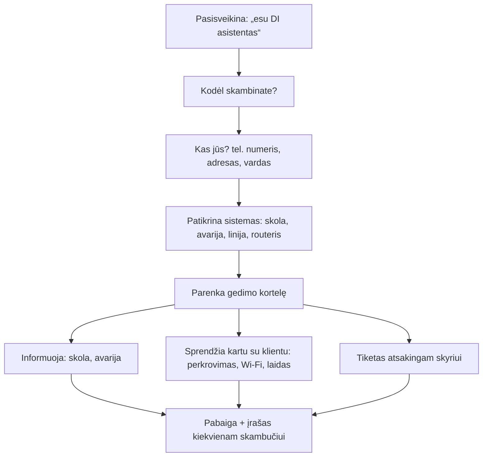
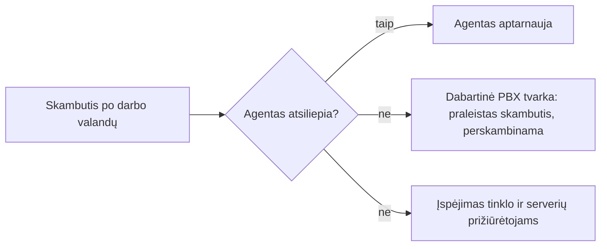
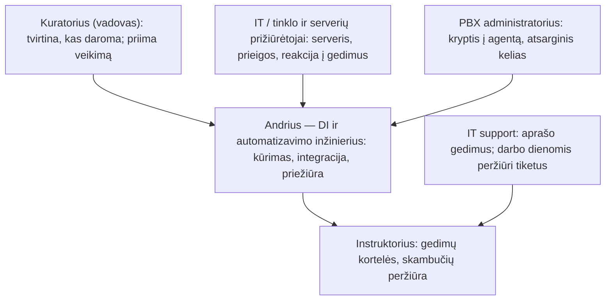

# 3. Kaip veikia ir kas už ką atsakingas

[← 2. Sprendimai](2-sprendimai.md) · [Turinys](README.md) · [4. Žinios →](4-zinios.md)

---

## Skambučio kelias

- **Pirma identifikacija.** Kol klientas nepatvirtintas, agentas nemato nei skolos, nei linijos.
- **Kiekvienas faktas turi šaltinį:** sistema arba kliento žodžiai su citata.
- **Sprendimas patikrinamas:** po perkrovimo agentas pats pažiūri į liniją, ar srautas grįžo.
- **Kiekvienas skambutis paliekamas įraše:** baigtis, priežastis, garso įrašas.

## Kai agentas neveikia

Agentas yra tokia pati sistema kaip CRM ar telefonija. Jo gedimus sprendžia tie, kurie prižiūri
tinklą ir serverius; jiems suteikiamos teisės ir pranešimai. Konkrečios situacijos ir veiksmai
sutariami kūrimo metu.

## Kas už ką atsakingas

| Rolė | Kas | Atsako už |
|---|---|---|
| **Kuratorius** | vienas iš vadovų | koordinuoja darbą įmonės pusėje; tvirtina, kad aptarta yra tai, ką darome; priima veikimą |
| **Kūrėjas** | Andrius | variklis, adapteriai, modeliai, diegimas; po paleidimo — priežiūra: analizuoja ir derina agento veikimą |
| **Instruktorius** | pradžioje Andrius, vėliau įmonės darbuotojas | gedimų kortelės, frazės, įranga; skambučių peržiūra. Andrius paruošia instruktoriaus vadovą ir rolę perduoda |
| **IT support** | įmonė | aprašo gedimus pagal šabloną; darbo dienomis peržiūri savaitgalio tiketus |
| **IT, tinklo ir serverių prižiūrėtojai** | įmonė | serveris, prieigos prie CRM, telemetrijos ir tiketų; reaguoja, kai agentas neveikia |
| **PBX administratorius** | įmonė arba tiekėjas | skambučių kryptis į agentą, atsarginis kelias |

Projekto metu visi atlikti darbai perduodami įmonei, o vystymą vėliau gali perimti kitas
darbuotojas.

---

[← 2. Sprendimai](2-sprendimai.md) · [Turinys](README.md) · [4. Žinios →](4-zinios.md)
