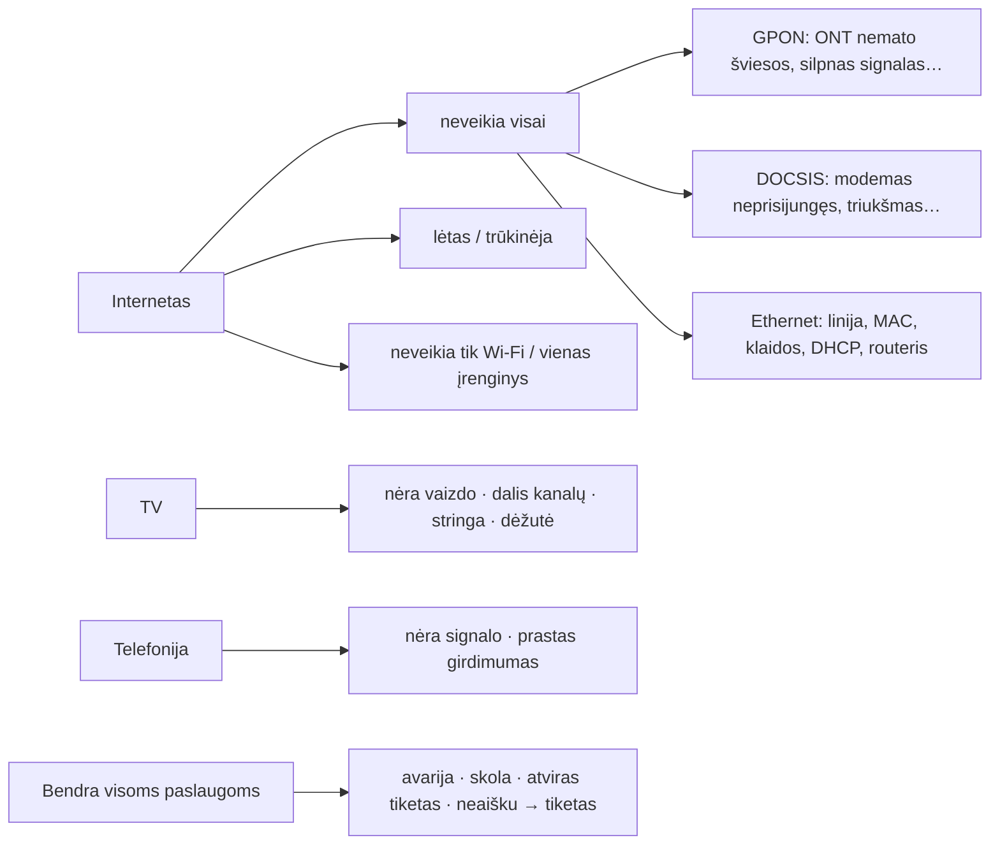
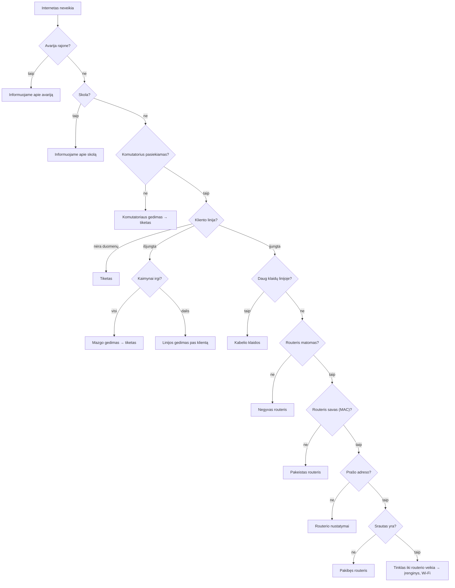
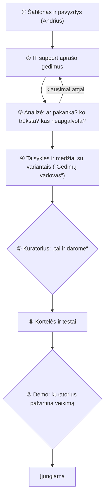

# 4. Žinios: gedimai ir jų aprašymas

[← 3. Kaip veikia](3-kaip-veikia.md) · [Turinys](README.md) · [5. Kas yra →](5-kas-yra.md)

---

Agentas žino tik tai, kas aprašyta. Todėl svarbiausias darbas yra **jūsų gedimų aprašymas**:
kaip IT support juos atpažįsta ir sprendžia dabar.

## Žinių modelis: simptomas → technologija → priežastis

Klientas pasako simptomą. Variklis pagal kliento technologiją parenka, ką tikrinti, ir randa
priežastį. Kiekviena priežastis yra viena **gedimo kortelė**.

Šiandien aprašyta: bendros kortelės ir „internetas neveikia“ Ethernet tinklui (7 priežastys), dalis
Wi-Fi ir įrenginių atvejų. Kitos technologijos ir paslaugos pridedamos palaipsniui.

## Kokių žinių reikia

| # | Sluoksnis | Klausimas |
|---|---|---|
| 1 | Paslaugos ir technologijos | kokios paslaugos ir technologijos; kaip CRM žymi kliento technologiją ir planą |
| 2 | Simptomai | ką ir kaip sako klientai; kaip dažnai |
| 3 | Priežastys | kokios galimos priežastys kiekvienam simptomui; iš ko jas atskirti |
| 4 | Ką mato sistemos | ką rodo telemetrija kiekvienai technologijai |
| 5 | Sprendimai | ką daro klientas, ką galima nuotoliu, kada meistras, ką rašyti tikete |
| 6 | Įranga | routerių, ONT, modemų, TV dėžučių modeliai: lemputės, mygtukai |
| 7 | Ribos ir kalba | ko nežadėti; įmonės terminai ir privalomos frazės |

## Vienas gedimas = viena procedūra

IT support kiekvieną gedimą aprašo kaip darbuotojo procedūrą. Tas pats aprašas tampa agento
kortele **ir** IT support vadovu naujiems darbuotojams.

| Eilutė | Ką aprašyti | Agento kortelėje |
|---|---|---|
| **Simptomas** | ką sako klientas | simptomas, žodynas |
| **Patikrinti** | kur (CRM, telemetrija…) ir ką rodo | kada tai šis gedimas; kas jį atmeta |
| **Išsiaiškinti** | ko paklausti klientą; galimi atsakymai | ko klausti |
| **Spręsti** | ką daryti pagal kiekvieną atsakymą | sprendimo šakos |
| **Įsitikinti** | iš ko matome, kad sutvarkyta | patikra |
| **Tiketas** | kada ir ką parašyti | perdavimas žmogui |

Taisyklė: rašyti **tai, ką matote ir darote**. Ne „patikrinam routerį“, o „sistemoje X laukas Y
rodo Z“. Pildoma tai, kas žinoma; trūkstamas vietas išsiaiškiname kartu.

### Pavyzdys 1 — interneto nėra dėl skolos

| | |
|---|---|
| Simptomas | „nėra interneto“ (arba TV) |
| Patikrinti | CRM: paslauga sustabdyta dėl skolos, suma |
| Išsiaiškinti | nieko |
| Spręsti | informuoti: suma, kaip ir kur sumokėti, kada paslauga atsinaujins |
| Įsitikinti | klientas informuotas |
| Tiketas | ne; jei klientas ginčija sumą — tiketas buhalterijai su jo argumentais |

### Pavyzdys 2 — interneto nėra, linijoje kitas MAC adresas

| | |
|---|---|
| Simptomas | „nėra interneto“ |
| Patikrinti | telemetrija: linijoje matomas įrenginys, bet ne tas, kuris užregistruotas |
| Išsiaiškinti | ① ar keitėte routerį? ② jei ne: į kurį routerio lizdą įjungtas tiekėjo kabelis (WAN ar LAN)? |
| Spręsti | keitė routerį → pririšti naują MAC, perjungti portą · kabelis LAN lizde → perkišti į WAN, pririšti, perjungti portą · kabelis WAN lizde → pririšti, perjungti portą |
| Įsitikinti | telemetrija: srautas yra, ir klientas patvirtina |
| Tiketas | pririšimas nepadėjo → „linijoje kitas įrenginys, pririšimas nepadėjo“ |

### Pavyzdys 3 — pakibęs routeris (demo skambutis ③)

| | |
|---|---|
| Simptomas | „nėra interneto“ |
| Patikrinti | telemetrija: komutatorius pasiekiamas, linija įjungta, routeris matomas ir gavo adresą, bet srauto nėra |
| Išsiaiškinti | nieko — perkrovimas vis tiek pirmas. Jei klientas pats sako, kad lemputės nedega, tai kitas gedimas |
| Spręsti | prieiti prie routerio → ištraukti maitinimą **iš lizdo**, ~5 s, įjungti |
| Įsitikinti | telemetrija: routeris dingo ir grįžo, srautas yra; klientas patvirtina. Jei sistema perkrovimo nematė — patikslinti (gal perkrauta ne ta dėžutė) ir kartoti vieną kartą |
| Tiketas | tik po perkrovimo: „perkrauta, neatsistatė“. Meistras nevažiuoja vien perkrauti routerio |

## Simptomų medis: kaip atskiriamos priežastys

Pavyzdys — „internetas neveikia“ Ethernet tinkle, sudarytas iš esamų agento kortelių:

Kai netinka nė viena priežastis — **neaiškus gedimas → tiketas** su viskuo, kas surinkta.

## Kaip atsiras jūsų žinios

Papildomi šaltiniai: pokalbių analizė ([8. Planas](8-planas.md)), tiketų istorija, esamos
instrukcijos ir įrangos dokumentai.

**Eilė** — pagal tai, kaip dažnai skambinama ir ar išsprendžiama telefonu:

1. bendros kortelės ir „neveikia“ dažniausiai technologijai;
2. likusios technologijos;
3. „lėtas internetas“ (dažnas, bet sudėtingiausias);
4. TV;
5. telefonija.

Šablonas „Kaip aprašyti gedimą“ bus atskiras dokumentas, parengtas projekto pradžioje.

Technikams: ką analizės metu tikriname kiekviename apraše

| Klausimas | Kortelės laukas |
|---|---|
| Kaip paaiškinti išvadą klientui vienu sakiniu? Kaip patvirtinti? | `explain` |
| Paslauga, simptomas, technologija | `service`, `symptom` |
| Iš ko suprantama, kad tai būtent šis gedimas (sistema · ką rodo · reikšmė)? | `when` |
| Kas rodo, kad tai kitas gedimas? | `rules_out` |
| Ko klausti; kodėl; kaip perklausti; ką manyti, jei neatsakė; kada neklausti; ar klientas pasako pats? | `needs` |
| Žingsniai: kas daro, kaip patikrinama, kad padaryta; ar vesti žingsnis po žingsnio? | `solution`, `pace` |
| Ar sprendimas skiriasi pagal atsakymą ar įrenginį? | `solution` šakos |
| Kokias klaidas daro klientai ir ką tada? | `on_fail` |
| Kada išspręsta? | `verify` |
| Kada tiketas, ką jame rašyti, ką meistras turi patikrinti? | `escalate` |
| Ko nežadėti ir nesiūlyti? | draudimai |
| Įranga: modeliai, lemputės, mygtukai | įrangos aprašai |
| Realūs atvejai | testų scenarijai |
| Informavimas (avarija, skola, tiketas): ką pasakyti, kokius faktus, ką siūlyti | informavimo kortelės |
| Įmonės lygiu: kaip CRM žymi technologiją ir planą; paslaugų priklausomybės; tiketų tipai ir kam skirti | bendri nustatymai |

---

[← 3. Kaip veikia](3-kaip-veikia.md) · [Turinys](README.md) · [5. Kas yra →](5-kas-yra.md)
