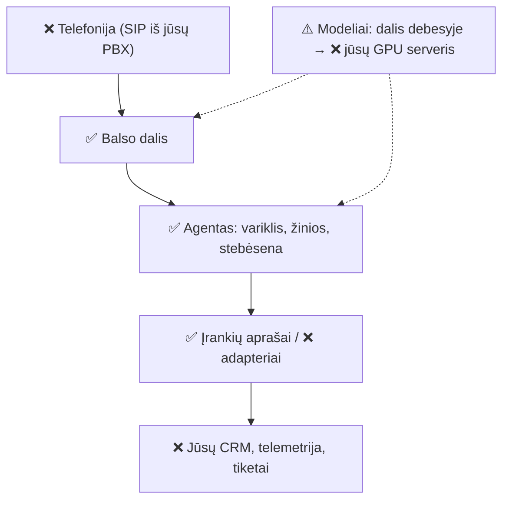

# 5. Kas jau yra ir ko trūksta

[← 4. Žinios](4-zinios.md) · [Turinys](README.md) · [6. Modeliai →](6-modeliai.md)

---

✅ veikia (demo) · ⚠️ veikia, bet produkcijai keičiama · ❌ reikia padaryti

## Trumpai

| Dalis | Būsena |
|---|---|
| Agento „smegenys“: variklis, gedimų kortelės, pokalbio eiga | ✅ veikia |
| Interneto gedimai (Ethernet), skola, avarija, tiketai, Wi-Fi ir įrenginiai | ✅ veikia demo |
| Stebėsena: kiekvieno skambučio baigtis, įrašas, „kodėl taip“ | ✅ veikia |
| Balsas lietuviškai, veikia vietoje | ✅ veikia |
| Kalbos modelis ir kalbos atpažinimas | ⚠️ dabar per debesį → bus jūsų serveryje |
| Jungtis prie jūsų CRM, telemetrijos, tiketų | ❌ integracija |
| Telefonija (tikras numeris) | ❌ integracija |
| GPON, DOCSIS, TV, telefonijos gedimai | ❌ pagal jūsų aprašus |
| Serveris, diegimas, įspėjimai | ❌ produkcijos paruošimas |

**Tikslas: viskas veikia jūsų serveryje; kliento balsas ir duomenys iš jo neišeina.**

Technikams: pilna lentelė

| Sritis | Dabar | Ko trūksta / produkcijoje | Etapas |
|---|---|---|---|
| **Telefonija** | balsas per naršyklę (WebRTC, Pipecat) | SIP jungtis su jūsų PBX, 8 kHz garsas, IVR kryptis po darbo valandų, atsarginis kelias | Telefonija |
| **Kalbos atpažinimas (ASR)** | ⚠️ Groq Whisper debesyje (JAV) | Whisper jūsų GPU serveryje | Serveris + modeliai |
| **Kalbos modelis (LLM)** | ⚠️ Gemma 4 26B per ES API (Scaleway); atsarginis — debesų modelis | tas pats atviras modelis jūsų serveryje (vLLM) | Serveris + modeliai |
| **Balsas (TTS)** | ✅ Piper vietoje, lietuviški balsai | — | — |
| **Variklis** | ✅ sprendimai, faktai su citata, identifikacija, sargas nuo nepagrįstų pažadų | zondas pagal kliento technologiją (GPON / DOCSIS / Ethernet) | Telemetrija |
| **Žinios** | ✅ 16 kortelių, 34 žingsniai, 10 įrangos aprašų; patikra prieš įjungiant, įjungiama be perkrovimo | jūsų gedimai, GPON, DOCSIS, TV, telefonija; lėtas internetas | Žinios |
| **Įrankiai** | ✅ 14 įrankių aprašų (CRM, telemetrija, avarijos, tiketai, nuotoliniai veiksmai) | ❌ adapteriai prie jūsų sistemų (dabar — demo duomenų bazė) | CRM, Telemetrija |
| **CRM** | demo duomenys | paieška pagal tel. ir adresą, paslaugos, įranga, skola, technologija; tik skaitymo paskyra; testinė aplinka | CRM + tiketai |
| **Telemetrija** | demo duomenys | linijos, įrenginio, signalo duomenys iš jūsų įrankių | Telemetrija |
| **Tiketai** | demo duomenys | kūrimas jūsų tiketų sistemoje | CRM + tiketai |
| **Stebėsena ir įrašai** | ✅ baigtys, įrašai, ėjimų paaiškinimai, versijos | prisijungimas, saugojimo terminai | Produkcijos paruošimas |
| **Testai** | ✅ ~2 100 automatinių testų + skambučių scenarijai | scenarijai iš jūsų realių pokalbių | Žinios |
| **Diegimas** | kūrėjo kompiuteryje | Docker, duomenų bazė, atsarginės kopijos, įspėjimai, atkūrimas | Produkcijos paruošimas |
| **Pokalbių analizatorius** | ASR ir LLM dalys yra | įrašų apdorojimas, struktūros ištraukimas, ataskaita | 0 etapas |
| **Instruktoriaus vadovas, „Gedimų vadovas“** | — | parengti ir perduoti | Piloto metu |
| **Įrankis darbuotojui** | — | darbuotojo ekranas: žmogus kalba, variklis siūlo | Po piloto |

---

[← 4. Žinios](4-zinios.md) · [Turinys](README.md) · [6. Modeliai →](6-modeliai.md)
