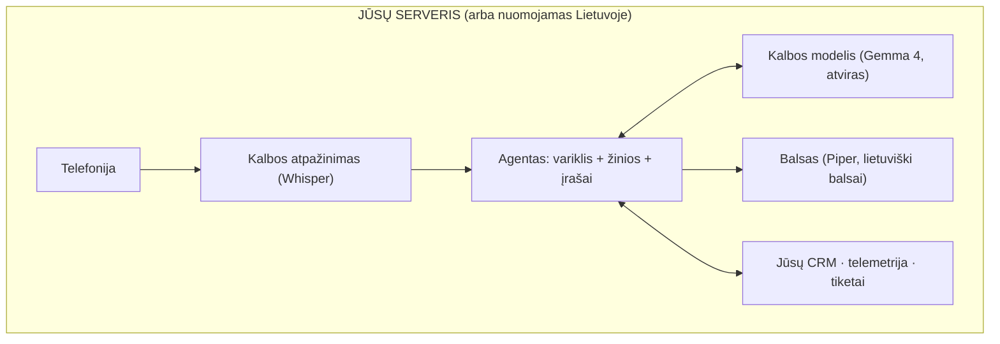

# 6. Modeliai jūsų serveryje

[← 5. Kas yra](5-kas-yra.md) · [Turinys](README.md) · [7. Integracija →](7-integracija.md)

---

**Kliento balsas ir duomenys iš serverio neišeina.**

## Kodėl tai svarbu

| | |
|---|---|
| **BDAR ir privatumas** | kliento balsas, adresas ir skola neperduodami trečiosioms šalims |
| **Nepriklausomybė** | nėra užsienio tiekėjo kainų, taisyklių, modelio pakeitimų ar išjungimo rizikos |
| **Patikimumas** | agentas nesustoja dėl to, kad sutriko svetimas API; modelio versija užfiksuota, todėl elgesys nesikeičia |
| **Atviri modeliai** | Gemma 4 — Apache 2.0 licencija: komercinis naudojimas be mokesčio už skambutį |
| **Nuspėjama kaina** | mokama už serverį, ne už kiekvieną žodį |

## Kur esame dabar

| Dalis | Dabar | Jūsų serveryje |
|---|---|---|
| Balsas | ✅ Piper vietoje | tas pats |
| Kalbos modelis | Gemma 4 per ES API — **tas pats atviras modelis** | GPU serveris |
| Kalbos atpažinimas | debesyje | Whisper GPU serveryje |
| Žinių paieška | ✅ vietoje | tas pats |

## Serveris

Geriausia vieta — ten, kur yra CRM ir kitos sistemos: greitesnė ir paprastesnė sąsaja. Ar
talpinti savo patalpose, pirkti įrangą, ar nuomotis — įmonės sprendimas.

| | Minimalus (pilotas) | Rekomenduojamas (produkcija) |
|---|---|---|
| GPU | 1× 48 GB (L40S / A40 / RTX 6000 Ada) | L40S 48 GB + rezervas (antra GPU arba antras serveris); daugiau skambučių vienu metu → H100 80 GB |
| CPU | 16 branduolių | 32 branduoliai |
| RAM | 64 GB | 128 GB |
| Diskas | 1 TB NVMe | 2 TB NVMe, RAID1, atsarginės kopijos |
| Aplinka | Ubuntu 24.04 LTS, Docker, NVIDIA tvarkyklės | + stebėsena, UPS |
| Tinklas | LAN prieiga prie PBX ir sistemų API; internetas tik atnaujinimams | + atskiras VLAN |
| Orientacinė kaina | nuoma Lietuvoje ~€400/mėn. (A40, 2026-10) | pagal pasirinkimą |

Technikams: atminties skaičiavimas

- Gemma 4 26B-A4B kvantuota (FP8 / INT4): ~15–26 GB GPU atminties.
- Whisper: ~3–5 GB.
- Likusi atmintis — vienu metu vykstantiems pokalbiams. Kiek skambučių telpa vienu metu,
  išmatuojama apkrovos testu serverio etape.
- Be GPU modelis per lėtas pokalbiui (~3,6 žodžio/s procesoriumi).
- Įrašai: 8 kHz garsas ≈ 1 MB/min → ~5 GB per mėnesį 1 000 penkių minučių skambučių.

**Lietuvių kalba.** Atvirų modelių lietuvių kalba silpnesnė nei didžiųjų debesų modelių. Tai
sušvelnina pati architektūra: variklis sprendžia, dalis sakinių yra paruoštos frazės, žodžių klaidas
taiso žodynas. Prireikus modelį galima derinti pagal jūsų pokalbius.

---

[← 5. Kas yra](5-kas-yra.md) · [Turinys](README.md) · [7. Integracija →](7-integracija.md)
