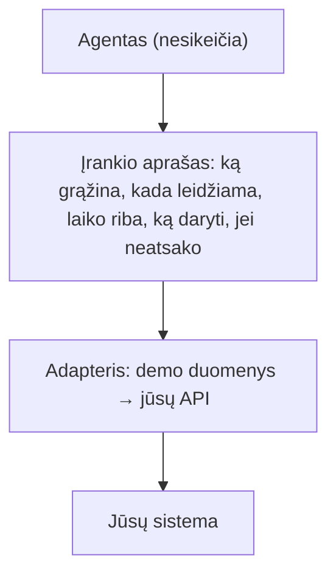
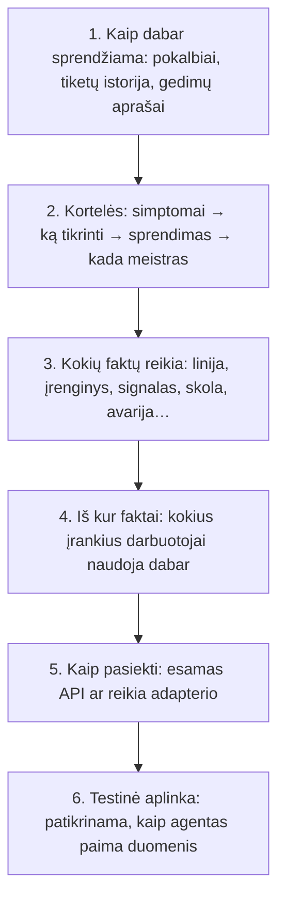

# 7. Pasiruošimas integracijai

[← 6. Modeliai](6-modeliai.md) · [Turinys](README.md) · [8. Planas →](8-planas.md)

---

## Principas: keičiasi tik jungtis

Kiekviena sistema agentui yra „įrankis“ su aprašu. Integruojant keičiamas tik **adapteris** —
kaip kalbėti su jūsų sistema. Variklis, kortelės ir pokalbis lieka tie patys. Jei sistema
neatsako, agentas nesugriūva: apraše nurodyta, ką daryti.

## Ką prijungti

| Jūsų sistema | Ko agentui reikia | Prieiga |
|---|---|---|
| **CRM / sąskaitos** | rasti klientą pagal telefoną ir adresą; paslaugos, technologija, įranga, skola | tik skaitymas |
| **Tinklo telemetrija** | linija, ar matomas įrenginys, signalas, srautas, klaidos, mazgas | tik skaitymas |
| **Avarijų registras** | aktyvios avarijos ir atstatymo laikas | tik skaitymas |
| **Tiketų sistema** | sukurti tiketą skyriui, papildyti atvirą | rašymas |
| **Nuotoliniai veiksmai** | porto perkrovimas, naujo routerio pririšimas | rašymas, vėliau ir su sąlygomis |
| **Telefonija (PBX)** | skambučių kryptis į agentą po darbo valandų; atsarginis kelias | — |

**Saugi tvarka:** pirma tik skaitymas → tada tiketai → nuotoliniai veiksmai tik vėliau ir tik su
sąlygomis. Prieš jungiant prie tikrų sistemų viskas patikrinama **testinėje aplinkoje** (staging).

## Darbų logika: nuo gedimų prie sistemų

Pradedama ne nuo sistemų, o nuo gedimų. Iš gedimų paaiškėja, kokių duomenų reikia, o iš to —
kokių įrankių ir adapterių.

## Technologijos

Įmonėje technologijos mišrios. Kiekvienai skiriasi simptomai, telemetrija ir sprendimai.

| Sritis | Būsena |
|---|---|
| **Nepriklauso nuo technologijos:** identifikacija, skola, avarija, atviras tiketas, užklausos, kliento įrenginiai (Wi-Fi, telefonas, kompiuteris) | ✅ veikia visiems klientams iš karto |
| Ethernet: portas, MAC, DHCP, klaidos | ✅ 7 kortelės |
| GPON: optinis signalas, ONT būsena | ❌ naujos kortelės + duomenys iš OLT |
| DOCSIS: modemo registracija, signalo kokybė | ❌ naujos kortelės + duomenys iš CMTS |
| TV: IPTV, skaitmeninė, analoginė | ❌ pagal jūsų aprašus |

Technologijos įvedamos **palaipsniui**, kai žinoma, kaip CRM vadina planus ir kaip iš jų atpažinti
kliento technologiją. Tada variklis parenka tinkamas korteles.

## Ko reikės iš įmonės

| Kas | Kam |
|---|---|
| **Kuratorius** iš vadovų | koordinuoja darbą įmonės pusėje, tvirtina sprendimus ir priima rezultatus |
| **IT support** | gedimų aprašai pagal šabloną; atsakymai į klausimus |
| **IT / tinklo administratorius** | prieigos prie CRM, telemetrijos, tiketų; testinė aplinka; serveris |
| **PBX administratorius** | kryptis į agentą, įrašai, statistika |
| **Sprendimas dėl serverio** | savas, pirkti ar nuomotis |
| **Nuotolinė prieiga kūrėjui** | darbas su testine aplinka |

Technikams: pradinis klausimynas (A–H)

#### A. Telefonija (PBX)
| Klausimas | Kodėl |
|---|---|
| PBX tipas ir versija (Asterisk/FreePBX, 3CX, tiekėjo debesų PBX…), kas administruoja | jungimo būdas ir darbų apimtis |
| Ar galima sukurti SIP vidinį numerį / trunk į agento serverį; kodekai (G.711) | agentas = dar viena PBX kryptis |
| IVR meniu struktūra, darbo laiko grafikas, šventės | kada skambutis eina agentui |
| Ar perduodamas skambinančiojo numeris (Caller ID) | identifikacija prasideda nuo numerio |
| Kaip dabar registruojami praleisti skambučiai ir perskambinama | atsarginis kelias, kai agentas neveikia |
| Įrašymo politika, privaloma frazė | BDAR |
| Ar įrašomi IT support pokalbiai; formatas; ar kliento ir darbuotojo kanalai atskiri | pokalbių analizei |
| Skambučių statistika (kiek po darbo valandų, kiek praleista) | naudos skaičiai |

#### B. CRM / sąskaitos
| Klausimas | Kodėl |
|---|---|
| Sistema, prieigos būdas (REST, SOAP, DB vaizdas) | adapterio tipas |
| Paieška pagal telefoną ir adresą; laukai: klientas, adresas, paslaugos, planas, technologija, įrangos modelis, MAC | identifikacija, technologija, įranga |
| Skola, balansas, paskutinis mokėjimas, sustabdymo būsena | skolos kortelė |
| Testinė aplinka (staging DB); atskira tik skaitymo paskyra | saugi pradžia |

#### C. Tinklas ir telemetrija
| Klausimas | Kodėl |
|---|---|
| Prieigos technologijos ir kiek klientų kiekvienoje | kokias korteles daryti pirma |
| Stebėsenos įrankiai (Zabbix, LibreNMS, gamintojo NMS, RADIUS, DHCP žurnalai…) ir jų API | iš kur imami faktai |
| Ką galima pamatyti apie vieną klientą: linija, įrenginys, signalas, srautas, klaidos, sesija | faktų žemėlapis |
| Avarijų registras: kur, ar su atstatymo laiku | avarijos kortelė |
| Nuotoliniai veiksmai: porto perkrovimas, MAC pririšimas, ONT perkrovimas; kas leidžia | vėlesnis etapas |
| Atsako laikas | pokalbio pauzės („tikrinu liniją“) |

#### D. Tiketai
| Klausimas | Kodėl |
|---|---|
| Tiketų sistema, API, privalomi laukai | tiketų adapteris |
| Tipai ir skyriai (meistras, buhalterija, pardavimai…) | kam skirtas tiketas |
| Kas peržiūri savaitgalio tiketus | procesas |
| Kas atsakingas už agento veiklas ir pranešimus | sutariama kūrimo metu |

#### E. Gedimai ir žinios
| Klausimas | Kodėl |
|---|---|
| Dažniausios skambučių priežastys | kurias korteles daryti pirma |
| Kurias sprendžia telefonu, kurias → meistras, kurių neliesti | kortelių ribos |
| Įranga: routerių, ONT, modemų, TV dėžučių modeliai | įrangos aprašai |
| Paslaugos ir jų priklausomybės (pvz., IPTV per internetą) | paslaugų žemėlapis |
| Įmonės terminai, pasisveikinimo tekstas | frazės |
| Esamos instrukcijos, tiketų istorija | papildomi šaltiniai |

#### F. Talpinimas
Kur yra CRM ir kitos sistemos; ar galima talpinti pas save; pirkti ar nuomotis. Įrangos
parametrai — [6. Modeliai](6-modeliai.md).

#### G. Teisė ir BDAR
| Klausimas | Kodėl |
|---|---|
| Duomenų apsaugos pareigūnas, įrašymo pranešimas, saugojimo terminai | įrašai ir kliento duomenys |
| DI prisistatymas | agentas jau prisistato kaip DI (ES DI akto skaidrumo reikalavimas) |

#### H. Organizacija
Kuratorius · kontaktinis žmogus · IT support (žinios) · IT (API, serveris) · PBX administratorius ·
nuotolinė prieiga · testinės aplinkos · sėkmės kriterijai pilotui.

---

[← 6. Modeliai](6-modeliai.md) · [Turinys](README.md) · [8. Planas →](8-planas.md)
