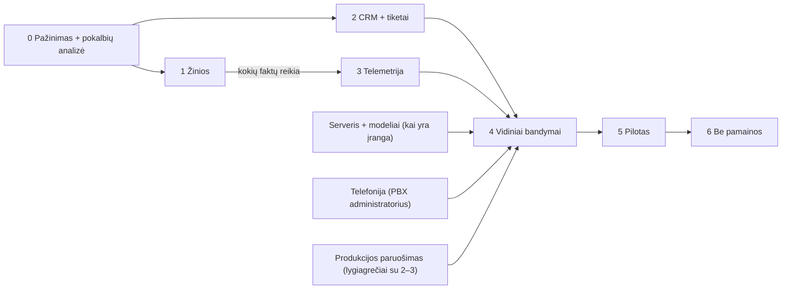
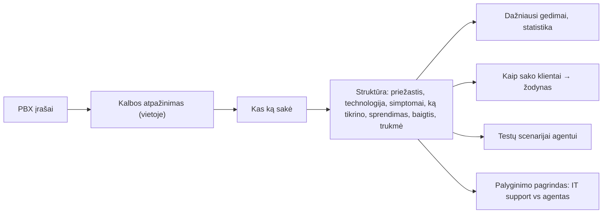

# 8. Planas ir laikas

[← 7. Integracija](7-integracija.md) · [Turinys](README.md) · [9. Klausimai →](9-klausimai.md)

---

> **Apytiksliai ~6 mėnesiai iki piloto.** Trukmės orientacinės. Dalis darbų vyksta lygiagrečiai.
> Jei etapas baigiamas greičiau, laikas skiriamas kokybei ir bandymams.

## Etapai

| Etapas | Trukmė | Ką daro Andrius | Ko reikia iš įmonės | Rezultatas |
|---|---|---|---|---|
| **0 Pažinimas** | 2–4 sav. | pokalbių analizė, tiketų istorija, sistemų žemėlapis, šablonas gedimams aprašyti | prieigos, žmonės, įrašai, PBX statistika | dažniausi gedimai, sistemų žemėlapis, apimtis |
| **1 Žinios** | 3–6 sav. | kortelės dažniausiems gedimams, įranga, frazės | IT support aprašo gedimus, kuratorius tvirtina | testai + scenarijai iš realių pokalbių |
| **2 CRM + tiketai** | 3–5 sav. | adapteriai, technologijos atpažinimas pagal planą | testinė aplinka, tik skaitymo paskyra | agentas atpažįsta klientą, mato skolą, kuria tiketą |
| **3 Telemetrija** | 4–8 sav. | duomenys pagal technologiją, adapteriai | prieiga prie stebėsenos įrankių / API | agentas mato tikrą liniją |
| **Serveris + modeliai** | 2–4 sav. (kai yra įranga) | modeliai serveryje, lietuvių kalbos ir delsos matavimai, apkrovos testas | serveris | viskas veikia jūsų serveryje |
| **Telefonija** | 1–3 sav. | SIP jungtis, kryptis po darbo valandų, atsarginis kelias | PBX administratorius | skambutis per tikrą numerį |
| **Produkcijos paruošimas** | 3–4 sav. | diegimas, atsarginės kopijos, įspėjimai, įrašų terminai | IT taisyklės, BDAR | diegimas ir atkūrimas patikrinti |
| **4 Vidiniai bandymai** | 2–4 sav. | taisymai | darbuotojai skambina kaip klientai | rasti trūkumai ištaisyti |
| **5 Pilotas** | 4–8 sav. | stebėsena, derinimas | sėkmės kriterijai, stebėjimas | kriterijai pasiekti |
| **6 Be pamainos** | — | priežiūra | sprendimas | savaitgaliai ir vakarai be pamainos |
| Instruktoriaus vadovas + „Gedimų vadovas“ | 3–5 sav. (piloto metu) | parengia, perduoda | darbuotojas perima | darbuotojas pats prideda kortelę |
| Įrankis darbuotojui | 6–10 sav. (po piloto) | darbuotojo ekranas | IT support išbando | — |

## Kas nuo ko priklauso

## Ką pamatysite po kiekvieno etapo

| Po | Demonstracija |
|---|---|
| 0 | **jūsų skambučių analizė:** dažniausi gedimai, kaip sprendžiama, kiek trunka; sistemų žemėlapis |
| 1 | jūsų gedimai agente; realūs pokalbiai paleisti per agentą — agento ir IT support sprendimų palyginimas |
| 2 | agentas atpažįsta tikrą klientą testinėje aplinkoje, mato skolą, kuria tiketą |
| 3 | agentas mato tikrą liniją |
| Serveris | viskas veikia jūsų serveryje; delsa ir skambučių skaičius vienu metu išmatuoti |
| Telefonija | skambutis per tikrą numerį |
| 5 | piloto ataskaita: agentas ir IT support pagal tuos pačius matus |

## Pokalbių analizė (0 etapas)

Kad nereikėtų klausytis visų įrašų, IT support pokalbiai apdorojami automatiškai jūsų serveryje:

- Padeda aprašyti procesus ir parodo, kaip dabar vyksta aptarnavimas ir kokia jo kokybė.
- Apimtis (tik vakarai ir savaitgaliai ar visi pokalbiai) parenkama pagal tai, kokie įrašai yra.
- Duomenys apdorojami įmonės serveryje; ataskaitose vardai ir adresai paslepiami.

## Kas gali pailginti terminą

Terminas priklauso nuo bendro darbo. Jis gali pailgėti, jei:

- vėluoja gedimų aprašai ar informacija apie juos;
- vėluoja prieigos prie sistemų ar testinės aplinkos;
- adapterius sistemoms reikia kurti įmonės pusėje;
- reikia papildomai derinti kalbos modelį lietuvių kalbai;
- integracijoje atsiranda kitų nenumatytų kliūčių.

Todėl kuratorius ir atsakingi žmonės įvardijami pačioje pradžioje.

---

[← 7. Integracija](7-integracija.md) · [Turinys](README.md) · [9. Klausimai →](9-klausimai.md)
